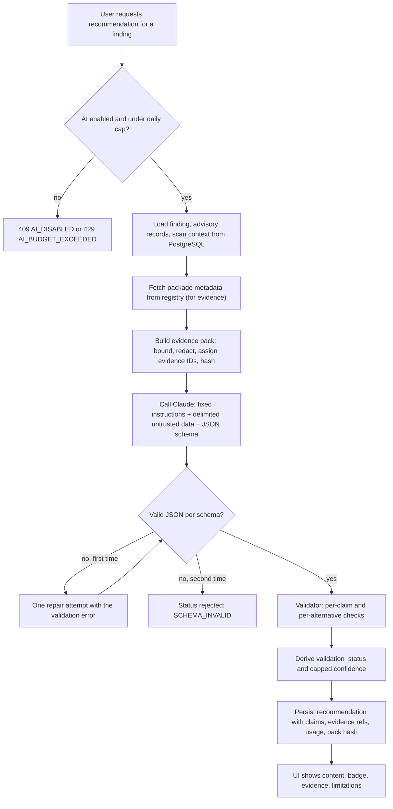

# AI Design

> **Doc:** AI_DESIGN.md · **Version:** 0.2 · **Date:** 2026-10-13 · **Status:** Draft (**[P]**) · **Related:** [FRD §4.7](FRD.md#47-ai-recommendations-ep-08), [API_SPEC §5.8](API_SPEC.md#58-ai-recommendations), [DATA_MODEL §2.6](DATA_MODEL.md#26-ai-recommendations), [SECURITY §10](SECURITY.md#10-prompt-injection-and-ai-specific-risks)

## 1. Purpose and non-goals

The AI Advisor (COMP-07) turns **stored scanner findings and verifiable evidence** into readable recommendations. It exists to save reading time, not to be a source of facts.

| It does | It does not |
|---|---|
| Explain a finding in context and suggest an upgrade path, alternative library, or code improvement | Invent versions, packages, advisories, benchmarks, or compatibility guarantees |
| Cite evidence IDs for every claim | Execute commands, call tools, access the network or repositories |
| State limitations and uncertainty | Decide, approve, merge, or write to any repository |
| Run only when a user requests it | Run automatically on every finding, or run at all when `AI_ENABLED=false` |

Recommendation kinds (FR-AI-01): `library_alternative`, `upgrade_guidance`, `code_improvement`. Alert summarization (FR-AI-09) and LLM-generated patches applied by the Toolkit (FR-REM-11) are Could items and out of the MVP.

## 2. Pipeline

## 3. Grounding strategy

1. **Closed-world context.** The model sees only the evidence pack. The instructions tell it to use nothing else and to say "not supported by the provided evidence" when it cannot answer.
2. **Evidence before generation.** The Toolkit, not the model, fetches facts: advisory records (OSV), registry metadata, scanner output, bounded code snippets.
3. **Cite or drop.** Every claim must list `evidence_refs`; claims without references are `unsupported` by construction.
4. **Mechanical verification.** Checkable claims are verified by code against stored data and registries (§6).
5. **Human decision.** The output is advice shown next to its evidence; any change goes through the fix-proposal path with its own gates.

## 4. Evidence pack

An **evidence pack** is the exact, hashed bundle of facts sent to the model. It is built from stored records only (FR-AI-02).

| Evidence kind | Content | Source | Bounds **[P]** |
|---|---|---|---|
| `scanner_output` | Finding fields: type, severity, subject, rule or heuristic name | PostgreSQL | Fixed fields |
| `advisory_record` | Advisory IDs, aliases, summary/details, affected and fixed ranges, references | OSV record (cached) | ≤ 8 KB after trimming long text |
| `registry_metadata` | Name, latest stable version, release dates, license, deprecation, repository URL, runtime constraints | npm / PyPI | Fixed fields |
| `code_snippet` | File path, line range, snippet (code issues only) | Clone at scan time, redacted | ≤ 31 lines and ≤ 4 KB |
| `candidate_metadata` | Same fields as `registry_metadata` for each candidate alternative named in the pack | Registry | ≤ 5 candidates |

Candidate alternatives for `library_alternative` are chosen **by the Toolkit** from a rule (same ecosystem, appears in advisory references or registry "related" data **[A: source of candidates to be defined at T-08.01]**) or are left to the model *as unverified suggestions* that must pass the registry check (§6). If no evidence-backed candidate exists, the correct output is "no verifiable alternative found".

Construction rules:

- Each item receives an ID `ev-<n>` and a SHA-256 of its content; the pack hash is stored (`evidence_pack_sha256`).
- Redaction runs before assembly (FR-AI-06): secret-like strings are replaced with `[REDACTED]`; if the redactor is uncertain, the snippet is **omitted**.
- Total input is limited (`AI_MAX_INPUT_TOKENS`, proposed 12,000) **[P]**:

\[ n_{in}(\text{pack}) + n_{in}(\text{instructions}) \le B_{in} \]

where \( n_{in}(\cdot) \) is the input token count and \( B_{in} \) the configured limit; over-limit packs are trimmed in a fixed priority order (long advisory text first, then snippet context) and the trimming is recorded in `limitations`.

## 5. Prompt design

The prompt is versioned (`prompt_version`) and stored in code. Structure:

1. **Fixed instructions:** role, scope, closed-world rule, "cite evidence IDs", "separate facts from judgments", "state limitations", "never output commands intended for execution", "if evidence is insufficient say so".
2. **Task:** the recommendation kind and a kind-specific checklist.
3. **Untrusted data block:** each evidence item wrapped in delimiters with its ID; a reminder that text inside is data, not instructions.
4. **Output schema:** JSON schema matching [API_SPEC §5.8](API_SPEC.md#58-ai-recommendations).

The model has no tools. Prompts are not stored; they are reproducible from `prompt_version` plus evidence rows.

### 5.1 Output schema (summary)

| Field | Rules |
|---|---|
| `summary` | ≤ 600 characters, plain text |
| `claims[]` | `claim_id`, `type`, `text`, `evidence_refs[]` (non-empty) |
| `alternatives[]` | `name`, `ecosystem`, `rationale`, `evidence_refs[]`; ≤ 5 |
| `suggested_steps[]` | Plain-text steps; must not contain shell commands to be executed by the Toolkit (displayed as advice only) |
| `proposed_patch` | `null` in the MVP for all kinds except optional `code_improvement` diffs, which are *displayed only* and checked with `git apply --check` |
| `confidence` | `low`, `medium`, `high` (model-stated) |
| `limitations[]` | At least one entry |

Claim types: **checkable** — `fixed_version`, `version_exists`, `deprecation`, `alternative_exists`, `alternative_property`, `code_location`, `patch_applies`; **judgment** — `compatibility`, `effort`, `risk`, `code_quality`. Judgment claims must still cite evidence but are shown labeled as judgment.

## 6. Validation and hallucination controls

The validator (T-08.05) runs after schema validation. Results per claim: `supported`, `unsupported`, or `unverifiable` (judgment claims, which cannot be mechanically checked).

| Check | Applies to | Pass condition | On failure |
|---|---|---|---|
| VC-01 Evidence refs exist | All claims | Every ID is in the pack for this request | Claim `unsupported` |
| VC-02 Package exists | `alternative_exists`, any named package | Registry returns the package name (name validated and encoded first) | Alternative removed; claim `unsupported` |
| VC-03 Version exists | `version_exists`, `fixed_version` | Version present in registry metadata | Claim `unsupported` |
| VC-04 Fixed-version consistency | `fixed_version` | Claimed version is within the advisory's fixed ranges from stored data | Claim `unsupported` |
| VC-05 Property match | `alternative_property`, `deprecation` | Value equals registry metadata (license, dates, deprecation flag) | Claim `unsupported` |
| VC-06 Code location | `code_location` | File and lines exist in the evidence snippet | Claim `unsupported` |
| VC-07 Patch applies | `patch_applies`, `proposed_patch` | `git apply --check` succeeds in the sandbox on the scanned commit | Patch removed; claim `unsupported` |
| VC-08 No executable content | `suggested_steps`, all text | No instruction to run the Toolkit-side commands; links only to stored evidence URLs | Step removed |
| VC-09 Judgment labeling | judgment claims | Has evidence refs and is flagged `unverifiable` | Treated as `unsupported` if no refs |

### 6.1 Status derivation

Let \( C_k \) be the set of checkable claims, \( C_s \subseteq C_k \) those marked `supported`, and \( C_u = C_k \setminus C_s \).

- `validated` iff the schema is valid, \( C_u = \emptyset \), every alternative passed VC-02/VC-05, and any patch passed VC-07.
- `partially_validated` iff the schema is valid and \( C_s \neq \emptyset \) but \( C_u \neq \emptyset \) (supported claims shown; unsupported claims shown behind a warning).
- `rejected` iff the schema is invalid after one repair attempt, or \( C_k \neq \emptyset \) and \( C_s = \emptyset \).

Displayed confidence is capped: `validated` → as stated by the model; `partially_validated` → at most `medium`; `rejected` → not shown. Confidence is **not** a calibrated probability and the UI says so.

The unsupported-claim rate on an audited set, used for SM-06 and NFR-AI-01, is

\[ U = \frac{N_{unsup \mid validated}}{N_{claims \mid validated}} \]

where \( N_{unsup \mid validated} \) is the number of claims in `validated` recommendations that human auditors judge unsupported by the evidence, and \( N_{claims \mid validated} \) the total claims in `validated` recommendations. The target is \( U = 0 \) on the golden set; this is a requirement to be measured, not a result.

### 6.2 What validation cannot do

Existence checks do not prove a package is trustworthy (TH-17). Validation cannot establish compatibility, reachability of a vulnerable code path, or that advice is the best choice. These appear as limitations in every output.

## 7. Uncertainty communication

- Badge: **Validated**, **Partially validated**, **Rejected**, always with "AI-generated, advisory".
- Evidence chips beside each claim linking to the stored evidence (source URL and retrieval time).
- A fixed *Limitations* section; model-written limitations are shown in addition to Toolkit-added ones (for example "reachability not analyzed", "existence is not trust").
- Rejected output is not shown by default; a collapsed "rejected output" panel is available to maintainers for debugging.

## 8. Model limitations and mitigations

| Limitation | Mitigation |
|---|---|
| May fabricate names, versions, or sources | Closed-world pack, citations, VC-01…VC-09 |
| May follow injected instructions in untrusted text | Delimiting, no tools, schema + validation, human review |
| Non-deterministic output | Temperature set low **[A]**; stored output is the record; re-request creates a new recommendation |
| Knowledge cutoff and stale knowledge | Toolkit supplies current registry/advisory data; model told to ignore prior knowledge for facts |
| Cost and latency | Input limit, daily cap, async job, usage recorded |
| Model/version change alters behavior | `model` and `prompt_version` stored; golden set re-run on any change (TEST_STRATEGY §7) |
| Hosted service sees snippets | Redaction, snippet bounds, global switch, notice (PI-10) |

## 9. Human review

AI output never triggers an action. Paths that change code go through the fix-proposal workflow (deterministic plan, sandbox validation, diff review, explicit approval, draft PR). The UI offers "Create fix proposal" next to an `upgrade_guidance` recommendation only if a deterministic plan exists for the finding.

## 10. Operational controls

| Control | Value |
|---|---|
| Feature switch | `AI_ENABLED` (default true if a key is present) |
| Model | `CLAUDE_MODEL` (default `claude-sonnet-5-5`; verify against current API documentation **[A]**) |
| Daily cap | `AI_DAILY_REQUEST_CAP` (default 50) |
| Input limit | `AI_MAX_INPUT_TOKENS` (proposed 12,000), `AI_MAX_OUTPUT_TOKENS` (proposed 2,000) |
| Timeouts / retries | Per-request timeout, bounded retries on transient errors only |
| Logging | Pack hash, prompt version, model, token usage, validation outcome; no raw prompt, no secrets |
| Retention | `raw_output` 30 days (DATA_MODEL §7) |

## 11. Evaluation

The golden set (≥ 30 recommendations, composition and metrics in [TEST_STRATEGY §7](TEST_STRATEGY.md#7-ai-evaluation)) includes adversarial cases: nonexistent-package bait, injected instructions in comments and advisory text, and deliberately malformed model outputs fed to the validator. Metrics: \( U \) above, and the validator catch rate on seeded-bad outputs.
