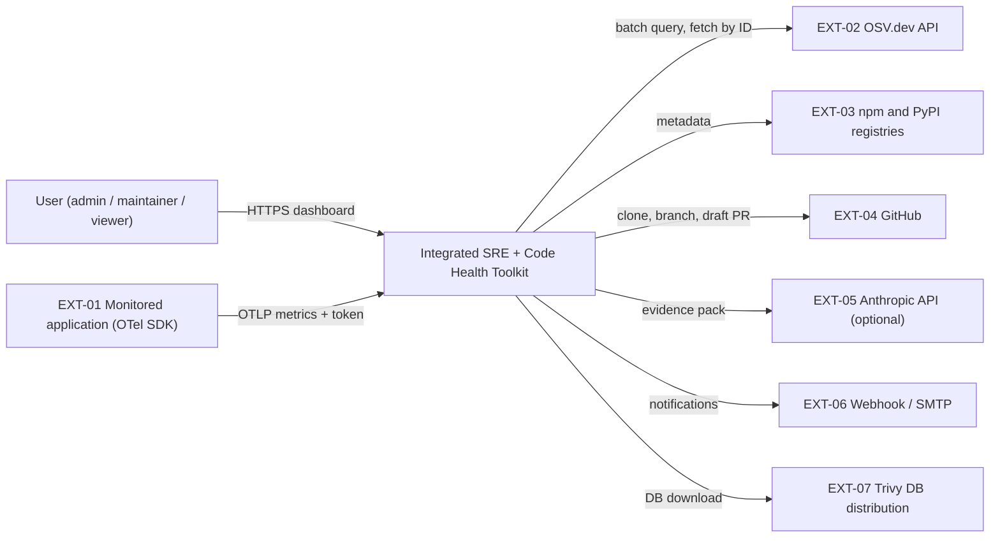
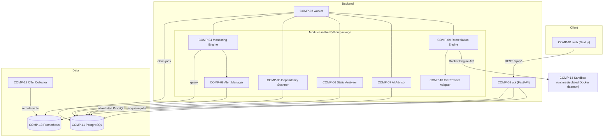
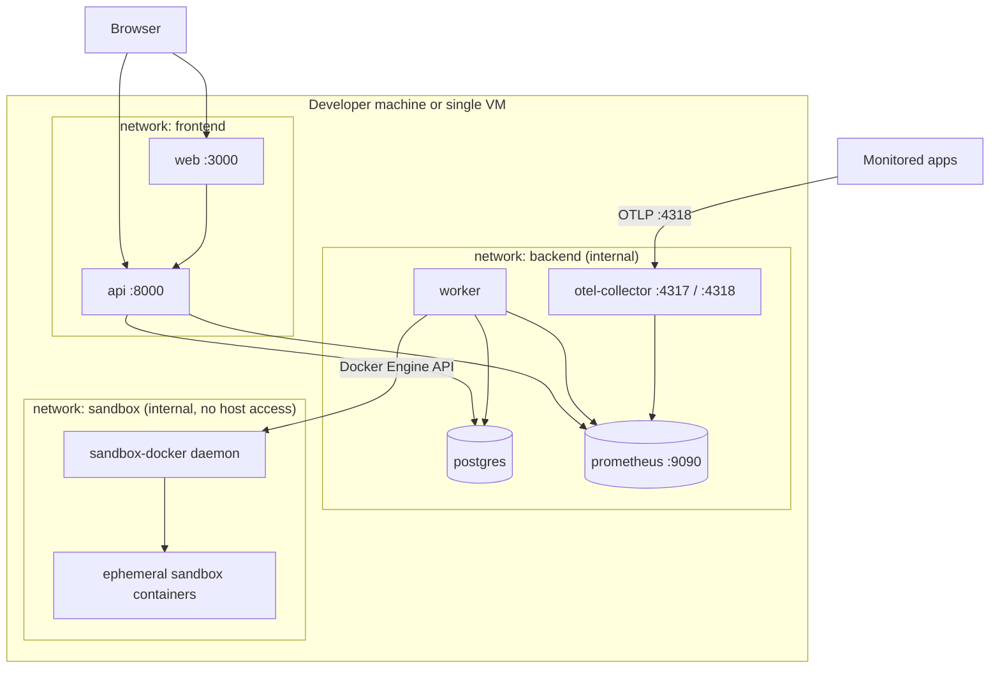
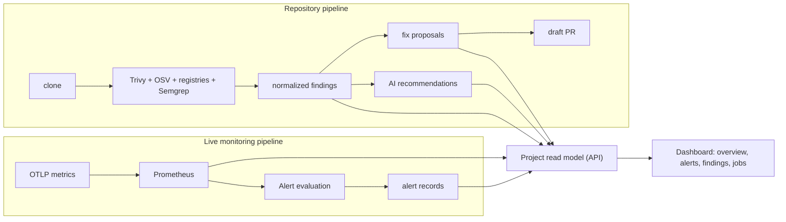

# Architecture

> **Doc:** ARCHITECTURE.md · **Version:** 0.1 · **Date:** 2026-10-13 · **Status:** Draft · **Related:** [SRS](SRS.md), [TRD](TRD.md), [WORKFLOW](WORKFLOW.md), [DATA_MODEL](DATA_MODEL.md)

## 1. Principles

1. **Separate pipelines, shared project view.** Monitoring, dependency scanning, static analysis, AI advice, alerting, and remediation are distinct components with distinct data. They converge only in the **Project** read model shown by the dashboard.
2. **Evidence before opinion.** Every finding, alert, and recommendation stores the evidence it came from.
3. **Humans authorize writes.** No component merges code; no remote write occurs without recorded approval.
4. **Untrusted code runs only in the sandbox.** Scanned repositories are data for the worker; their code executes only in COMP-14.
5. **Fail visibly.** Partial results are labeled partial; an unavailable provider is never reported as "clean".
6. **Simplest thing that works** for a student team: one Python package, one database, no message broker.

## 2. System context

## 3. Components

### 3.1 Responsibilities

| ID | Component | Responsibility | Sync/Async | Persists | Must NOT |
|---|---|---|---|---|---|
| COMP-01 | `web` | UI, navigation, polling job status, rendering evidence and diffs | Sync UI; polls | Nothing (no secrets in browser storage) | Call third parties directly; hold tokens other than the session |
| COMP-02 | `api` | AuthN/Z, validation, CRUD, read models, enqueue jobs, proxy allowlisted metric queries | Sync request/response; returns `202` for jobs | PostgreSQL | Run scanners, clone repos, or execute repository code |
| COMP-03 | `worker` | Claims jobs, runs scan/AI/remediation/PR jobs, runs the monitoring loop and scheduler | Async | PostgreSQL (job state) | Execute repository code outside COMP-14 |
| COMP-04 | Monitoring Engine | Every \( \Delta_{eval} \): evaluate rules via Prometheus, update target status | Async loop | Via COMP-08 / PG | Infer code-level causes |
| COMP-05 | Dependency Scanner | Inventory, vulnerabilities (Trivy + OSV), outdated/incompatibility checks, normalization | Async (job) | `scan`, `dependency`, `finding`, `evidence` | Modify the repository |
| COMP-06 | Static Analyzer | Run Semgrep, normalize code issues | Async (job) | `finding`, `evidence` | Conclude runtime health from static results |
| COMP-07 | AI Advisor | Build evidence pack, call Claude, validate, store recommendation | Async (job) | `recommendation` | Execute commands; write to repos; use data outside the evidence pack |
| COMP-08 | Alert Manager | Dedupe, lifecycle, evidence attach, notification delivery | Async | `alert`, `notification_delivery` | Auto-remediate |
| COMP-09 | Remediation Engine | Deterministic change plans, sandbox orchestration, validation, delta re-scan, PR creation after approval | Async | `fix_proposal`, `validation_run` | Merge, push to default branch, run LLM-provided commands |
| COMP-10 | Git Provider Adapter | GitHub operations through a minimal interface (clone URL, create branch, open draft PR, close PR, delete own branch) | Sync calls inside jobs | None | Accept branch names outside `toolkit/fix/` |
| COMP-11 | PostgreSQL | Relational system of record and job queue | — | All relational data | Store time-series |
| COMP-12 | OTel Collector | Receive OTLP, validate token, forward metrics | Streaming | None | Store data |
| COMP-13 | Prometheus | Time-series storage and PromQL | — | Time series (retention-limited) | Store findings or alerts |
| COMP-14 | Sandbox runtime | Isolated execution of dependency installation and tests | Async | Ephemeral volumes only | Share a socket, volume, or network with the host stack |

### 3.2 What each source can and cannot tell you

| Source | Can support | Cannot support |
|---|---|---|
| Runtime metrics (COMP-13) | "Error ratio of service X exceeded threshold since 14:02"; "no data since 14:10" | Which line of code is defective; whether a vulnerable dependency is exploited |
| Dependency scan (COMP-05) | "Package P@V matches advisory A; fixed in V2" | Whether the vulnerable function is reachable at runtime; whether production runs this version |
| Static analysis (COMP-06) | "Rule R matched at file:line" | Runtime health; absence of bugs |
| AI Advisor (COMP-07) | Suggestions tied to stored evidence, validated mechanically | Facts not in the evidence pack; guarantees of compatibility |
| Sandbox tests (COMP-14) | "Repository's own tests passed/failed after the change" | Correctness beyond test coverage |

The dashboard places these side by side per project and offers a time-ordered activity view (FR-DSH-07). It never draws causal links automatically.

## 4. Persistence and data ownership

| Data | Store | Written by | Notes |
|---|---|---|---|
| Users, projects, repositories, targets, rules | PostgreSQL | api | Secrets encrypted ([DATA_MODEL §8](DATA_MODEL.md#8-sensitive-data-handling)) |
| Metrics (time series) | Prometheus | otel-collector | Retention configured on Prometheus |
| Alerts, deliveries | PostgreSQL | worker (COMP-08) | Evidence snapshot stored inline |
| Scans, dependencies, findings, evidence | PostgreSQL | worker | Evidence includes bounded snippets |
| Recommendations | PostgreSQL | worker (COMP-07) | Stores validation results and evidence refs |
| Fix proposals, validation runs, diffs | PostgreSQL | worker (COMP-09) | Diff stored as text |
| Jobs | PostgreSQL | api (enqueue), worker (update) | Lease-based |
| Repository clones | Ephemeral worker disk | worker | Deleted at job end |
| Sandbox workspaces | Ephemeral sandbox volumes | worker via COMP-14 | Deleted at stage end |

## 5. Synchronous versus asynchronous behavior

| Operation | Mode | Client experience |
|---|---|---|
| Login, CRUD, reads, metric queries | Synchronous | Immediate response |
| Repository verification | Synchronous with 10 s timeout **[P]** | Immediate result or error |
| Scan, AI recommendation, fix proposal, PR creation | Asynchronous job | `202` + job ID; poll `GET /jobs/{id}` (DEC-015) |
| Alert evaluation | Background loop | Alerts appear in UI/notifications |
| Scheduled rescans | Background scheduler | New scan rows |

## 6. Deployment topology (Docker Compose)

Notes: the diagram simplifies networking. Containers on an *internal* network have no internet access, so `api` and `worker` are additionally attached to a default egress network for the allowlisted outbound calls (GitHub, OSV, registries, Anthropic); `postgres`, `prometheus`, and the sandbox daemon are not. `api` and `worker` share one image with different commands. Only `web`, `api`, and `otel-collector` publish host ports; Prometheus is published only in development. The sandbox daemon is reachable only by `worker`. A feasibility spike (UD-03) must confirm this layout on all team machines; if it fails, `REMEDIATION_ENABLED=false` and proposals stop at the plan stage.

## 7. Convergence in the unified dashboard

The **Project** is the join key: a project may own one repository and several monitoring targets. The API composes overview data from PostgreSQL (alerts, scans, findings) and Prometheus (current metrics). Neither pipeline reads the other's tables.

## 8. Failure modes and degradation

| Failure | Behavior |
|---|---|
| Prometheus down | Monitoring views show error state; alert evaluation pauses and records an `evaluation_error` event; other features continue (NFR-REL-05). |
| OSV or registry unreachable | Scan `partial`; provider status shown (FR-DEP-07). |
| Trivy DB cannot update | Scan uses cached DB if present and labels the DB age; otherwise provider `failed`. |
| Anthropic unavailable / over budget | AI job `failed` with reason; no effect on other features. |
| Worker crash | Lease expires; job requeued up to 3 attempts (NFR-REL-01). |
| Sandbox unavailable | Fix proposal fails with `SANDBOX_UNAVAILABLE`; no remote writes occur. |
| GitHub rejects push/PR | Proposal returns to `approved` with `pr_error`; no retry loop without user action. |

## 9. Scalability and limits

The design is a single-node system sized for NFR-CAP-01. The Postgres-backed queue and in-process loops are deliberate simplifications. Scaling beyond the envelope would need a broker, multiple workers with shard-aware scheduling, and remote-write storage; these are **not** designed here.

## 10. Architectural decisions (summary)

| ID | Decision | Status |
|---|---|---|
| DEC-001 | Monorepo; one Python package for API and worker | Proposed |
| DEC-002 | PostgreSQL as system of record | Proposed |
| DEC-003 | Postgres-backed job queue | Proposed |
| DEC-004 | OTLP → Collector → Prometheus; metrics only | Proposed (UD-06) |
| DEC-005 | In-app alert evaluation using PromQL; Alertmanager deferred | Proposed |
| DEC-006 | Trivy primary, OSV cross-check/enrichment | Proposed |
| DEC-007 | Semgrep CE with licensing caveat | Proposed (UD-01) |
| DEC-008 | Claude via SDK, advisory only, model configurable | Proposed (UD-05) |
| DEC-009 | GitHub with fine-grained PAT | Proposed (UD-02) |
| DEC-010 | Dedicated isolated Docker daemon for sandbox | Proposed (UD-03) |
| DEC-011 | Toolkit never merges; draft PRs only after explicit approval | Accepted by requirements |
| DEC-012 | npm and PyPI only | Proposed |
| DEC-013 | Local auth with global roles | Proposed |
| DEC-014 | Single-tenant, one OTLP ingest token | Proposed |
| DEC-015 | Next.js App Router; polling for job status | Proposed |

Rationale and trade-offs: `DECISIONS.md` (batch 2).
