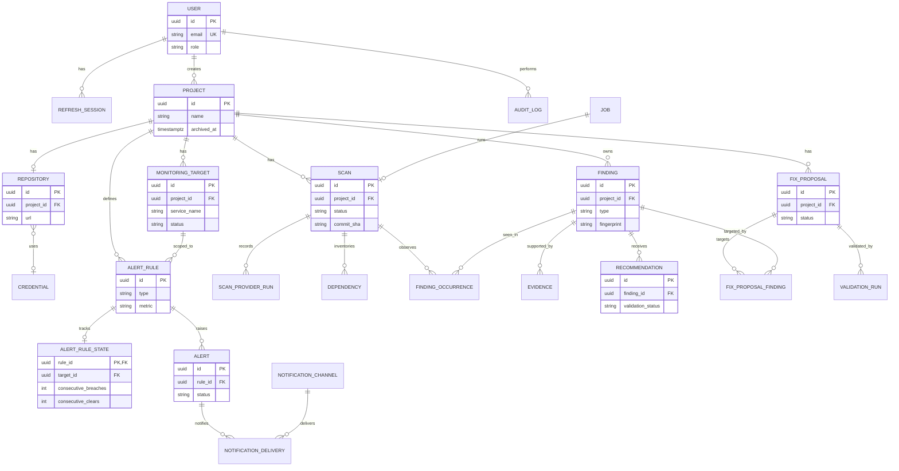

# Data Model

> **Doc:** DATA_MODEL.md · **Version:** 0.1 · **Date:** 2026-10-13 · **Status:** Draft (**[P]**) · **Related:** [ARCHITECTURE](ARCHITECTURE.md), [API_SPEC](API_SPEC.md), [SRS](SRS.md)

Relational data lives in PostgreSQL (COMP-11), managed by Alembic migrations. Time-series data lives only in Prometheus (COMP-13) and is **not** modeled here beyond the label contract in §9. All primary keys are UUIDs; all timestamps are `timestamptz` in UTC.

## 1. Entity-relationship overview

Entities not drawn with attributes (for readability) are specified in §2.

## 2. Entity definitions

`NN` = NOT NULL. `JSONB` columns have a documented shape in the cited section or in [API_SPEC](API_SPEC.md).

### 2.1 Identity and access

**`user`**

| Column | Type | Notes |
|---|---|---|
| id | uuid PK | |
| email | citext, UNIQUE, NN | Case-insensitive |
| display_name | text NN | ≤ 100 chars |
| password_hash | text NN | Argon2id encoded hash |
| role | enum `user_role` NN | `viewer, maintainer, admin` |
| is_active | boolean NN | Default true; deactivation revokes sessions |
| created_at, updated_at, last_login_at | timestamptz | |

**`refresh_session`**: `id`, `user_id` FK, `token_hash` (SHA-256 of opaque token, UNIQUE), `created_at`, `expires_at`, `revoked_at` null.

**`audit_log`**: `id`, `actor_id` FK null (system actions), `action` text (e.g., `auth.login_failed`, `repo.credential_created`, `scan.triggered`, `fix.approved`, `fix.pr_opened`, `fix.admin_override`), `resource_type`, `resource_id`, `metadata` JSONB (no secrets), `created_at`. Append-only by convention (no update/delete endpoints).

### 2.2 Projects, repositories, targets

**`project`**: `id`, `name` NN, `description`, `archived_at` null, `created_by` FK, `created_at`, `updated_at`. Unique `lower(name)` where `archived_at IS NULL`.

**`credential`**: `id`, `kind` (`github_pat`), `ciphertext` bytea NN, `nonce` bytea NN, `key_id` text NN (supports key rotation), `created_by`, `created_at`. Never selected by list endpoints.

**`repository`**: `id`, `project_id` FK UNIQUE, `provider` (`github`), `owner`, `name`, `url`, `default_branch`, `ecosystems` text[] (⊆ `{npm,pypi}`), `test_command` null, `credential_id` FK null, `can_open_prs` boolean, `verified_at` null, `created_at`.

**`monitoring_target`**: `id`, `project_id` FK, `name`, `service_name`, `environment`, `ingestion_mode` (`otlp_push` | `prometheus_scrape`), `scrape_url` null (scrape mode only; validated like webhook URLs), `status` (`waiting` | `receiving` | `stale`), `last_seen_at` null, `created_at`. UNIQUE `(project_id, service_name, environment)`.

### 2.3 Alerting

**`alert_rule`**: `id`, `project_id` FK, `target_id` FK, `name`, `type` (`threshold|anomaly|absence`), `metric` (`error_ratio|latency_p95|request_rate|data_absent`), `comparator` (`gt|lt`) null, `threshold` double null, `window` (`1m|5m|15m`) null, `duration_seconds` int, `resolve_after` int default 3, `params` JSONB (anomaly: `baseline_points`, `z_threshold`, `consecutive`), `severity` (`critical|high|medium|low|info`), `guidance` text, `enabled` boolean, `created_by`, `created_at`.

**`alert`**: `id`, `rule_id` FK, `target_id` FK, `project_id` FK, `status` (`firing|acknowledged|resolved`), `severity`, `first_seen_at`, `last_seen_at`, `occurrence_count` int, `evidence` JSONB (`query`, `observed_value`, `threshold`, `window`, `guidance`, optional `z_score`), `acknowledged_by` FK null, `acknowledged_at`, `resolved_at`, `resolved_by` FK null (null = automatic). **Partial unique index** on `(rule_id, target_id) WHERE status <> 'resolved'` enforces FR-ALR-03.

**`alert_rule_state`**: `rule_id` PK (FK `alert_rule.id` ON DELETE CASCADE), `target_id` FK (`monitoring_target.id` ON DELETE CASCADE), `breach_since` null timestamptz, `consecutive_breaches` int default 0, `consecutive_clears` int default 0, `last_evaluated_at` null timestamptz, `last_value` null double, `last_outcome` null text. Survives worker and loop process restarts to guarantee breach accumulation and clear counters are durable across restarts.

**`notification_channel`**: `id`, `type` (`webhook|email`), `name`, `config_ciphertext` bytea + `nonce` + `key_id` (webhook URLs may embed secrets), `enabled`, `created_by`, `created_at`.

**`notification_delivery`**: `id`, `alert_id` FK, `channel_id` FK, `event` (`firing|resolved`), `status` (`sent|failed|suppressed`), `http_status` null, `error` null, `attempted_at`.

### 2.4 Jobs

**`job`**: `id`, `type` (`scan|recommendation|fix_proposal|pr_creation`), `status` (`queued|running|succeeded|partial|failed|cancelled`), `stage` text null, `attempts` int, `max_attempts` int default 3, `locked_by` text null, `lease_expires_at` null, `payload` JSONB, `error_code` null, `error_message` null (sanitized, ≤ 500 chars), `cancel_requested` boolean, `resource_type`, `resource_id`, `created_by` FK null, `created_at`, `started_at`, `finished_at`. Claim query: `… WHERE status='queued' ORDER BY created_at FOR UPDATE SKIP LOCKED LIMIT 1`; lease reaper requeues expired `running` rows (NFR-REL-01).

### 2.5 Scanning and findings

**`scan`**: `id`, `project_id` FK, `repository_id` FK, `job_id` FK, `ref`, `commit_sha` null until resolved, `status` (`queued|running|succeeded|partial|failed|cancelled`), `trigger` (`manual|scheduled`), `summary` JSONB, `created_by` null (scheduled), `created_at`, `started_at`, `finished_at`.

**`scan_provider_run`**: `id`, `scan_id` FK, `provider` (`trivy|osv|registry|semgrep`), `status` (`ok|failed|skipped`), `duration_ms`, `error` null (sanitized), `tool_version` null, `db_info` JSONB null (e.g., scanner database build timestamp, so users see data freshness).

**`dependency`**: `id`, `scan_id` FK, `ecosystem` (`npm|pypi`), `name`, `version`, `scope` (`direct|transitive`), `manifest_path`, `purl` null. UNIQUE `(scan_id, ecosystem, name, version, manifest_path)`.

**`finding`** (project-level identity across scans)

| Column | Type | Notes |
|---|---|---|
| id | uuid PK | |
| project_id | uuid FK NN | |
| type | enum `finding_type` NN | `dependency_vulnerability, dependency_outdated, dependency_incompatibility, code_issue` |
| fingerprint | text NN | Hex SHA-256 per [TRD §5.2](TRD.md#52-fingerprint) |
| title | text NN | |
| severity | enum null | `critical, high, medium, low, info`; null = unrated |
| severity_source | text null | `osv`, `trivy`, `semgrep`, `heuristic` |
| status | enum NN | `open, dismissed, resolved` |
| ecosystem, package_name, package_version | text null | dependency findings |
| scope, manifest_path | text null | dependency findings |
| file_path, line_start, line_end, rule_id | text/int null | code findings |
| advisory | JSONB null | `{ids[], aliases[], fixed_versions[], references[]}` |
| detail | JSONB null | heuristic name and parameters for outdated/incompatibility (e.g., `{"installed":"1.2.3","latest":"2.0.0","lag":"major"}`) |
| sources | text[] NN | Providers that reported it |
| dismissal_reason | enum null | `false_positive, accepted_risk, wont_fix` |
| dismissal_note, dismissed_by, dismissed_at | | |
| first_seen_scan_id, last_seen_scan_id, resolved_scan_id | uuid null | |
| first_seen_at, last_seen_at | timestamptz | |

UNIQUE `(project_id, fingerprint)`.

**`finding_occurrence`**: `id`, `scan_id` FK, `finding_id` FK, `fingerprint`, `change` (`new|unchanged`). UNIQUE `(scan_id, fingerprint)` (NFR-REL-04). "Resolved" is represented by `finding.status = 'resolved'` with `resolved_scan_id`.

**`evidence`**: `id`, `finding_id` FK, `scan_id` FK, `evidence_key` text (`ev-1`, `ev-2`… unique per finding+scan), `kind` (`advisory_record|registry_metadata|code_snippet|scanner_output`), `source` (`osv|trivy|npm|pypi|semgrep`), `url` null, `content` JSONB (bounded: snippet ≤ 31 lines and ≤ 4 KB; advisory record ≤ 64 KB **[P]**), `content_sha256`, `retrieved_at`. Evidence is **immutable**.

### 2.6 AI recommendations

**`recommendation`**: `id`, `finding_id` FK, `kind` (`library_alternative|upgrade_guidance|code_improvement`), `status` (`pending|completed|failed`), `validation_status` (`validated|partially_validated|rejected`) null until complete, `model` text, `prompt_version` text, `evidence_pack_sha256` text (hash of exact pack sent), `content` JSONB (`summary, claims[], alternatives[], suggested_steps[], proposed_patch, confidence, limitations[]` as in API_SPEC §5.8), `raw_output` text null (purged per §7), `usage` JSONB (`input_tokens, output_tokens`), `feedback_rating` null, `feedback_comment` null, `requested_by` FK, `job_id` FK, `created_at`, `completed_at`. Raw prompts are **not** stored; they are reproducible from `prompt_version` + evidence rows.

### 2.7 Remediation

**`fix_proposal`**: `id`, `project_id` FK, `status` (`pending|validating|ready|approved|pr_opened|rejected|failed|superseded`), `base_commit_sha`, `changes` JSONB (array as in API_SPEC §5.9), `has_major_bump` boolean, `diff` text null, `validation_result` (`passed|failed|unverified|not_run`), `delta_scan` JSONB null, `risk_notes` JSONB, `approved_by` FK null, `approved_at` null, `approval_ack` JSONB null (`acknowledge_unverified`, `acknowledge_breaking_change`, `comment`, `admin_override` boolean), `pr_number` int null, `pr_url` null, `pr_branch` null (must match `^toolkit/fix/[0-9a-f]{8}-[0-9a-f]{4}-[0-9a-f]{4}-[0-9a-f]{4}-[0-9a-f]{12}$`, CHECK constraint), `pr_error` null, `requested_by` FK, `job_id` FK, `created_at`, `updated_at`.

**`fix_proposal_finding`**: `fix_proposal_id` FK, `finding_id` FK; PK on both.

**`validation_run`**: `id`, `fix_proposal_id` FK, `stage` (`baseline|apply|post_change|rescan`), `status` (`passed|failed|skipped|error`), `exit_code` null, `duration_s`, `output_tail` text (last ≤ 8 KB, secrets redacted), `started_at`, `finished_at`. The API's `validation.baseline` and `validation.post_change` objects are projections of these rows.

## 3. Enumerations (single source of truth)

| Enum | Values |
|---|---|
| `user_role` | viewer, maintainer, admin |
| `severity` | critical, high, medium, low, info |
| `finding_type` | dependency_vulnerability, dependency_outdated, dependency_incompatibility, code_issue |
| `finding_status` | open, dismissed, resolved |
| `scan_status` / `job_status` | queued, running, succeeded, partial, failed, cancelled |
| `provider_status` | ok, failed, skipped |
| `alert_status` | firing, acknowledged, resolved |
| `target_status` | waiting, receiving, stale |
| `recommendation_kind` | library_alternative, upgrade_guidance, code_improvement |
| `validation_status` | validated, partially_validated, rejected |
| `proposal_status` | pending, validating, ready, approved, pr_opened, rejected, failed, superseded |
| `validation_result` | passed, failed, unverified, not_run |

## 4. Indexes (minimum set)

| Table | Index | Purpose |
|---|---|---|
| finding | `(project_id, status, severity)`; `(project_id, type)`; unique `(project_id, fingerprint)` | Explorer filters, upsert |
| finding | GIN on `advisory` (optional) | Search by advisory ID |
| finding_occurrence | unique `(scan_id, fingerprint)`; `(finding_id)` | Idempotency, history |
| dependency | unique `(scan_id, ecosystem, name, version, manifest_path)` | Inventory |
| alert | partial unique `(rule_id, target_id) WHERE status <> 'resolved'`; `(project_id, status)` | Dedupe, lists |
| job | `(status, created_at)`; `(lease_expires_at) WHERE status='running'` | Queue claim, lease reaper |
| scan | `(project_id, created_at DESC)` | History |
| audit_log | `(created_at)`, `(actor_id, created_at)` | Review |

## 5. Data lineage: origin, meaning, validation, storage

| Data | Origin | Meaning | Validation | Stored in |
|---|---|---|---|---|
| Metrics | Monitored app via OTLP | Observed request counts and latency histograms | Token check at collector; query templates only | Prometheus |
| `target.status` | Derived from presence of samples | Data is arriving, not "app is healthy" | Computed server-side | `monitoring_target` |
| `alert` | Rule evaluation over PromQL | A stated condition held for the required duration | Rule schema; dedupe index; evidence snapshot | `alert` |
| `dependency` | Trivy inventory from manifests/lockfiles | Packages the repo resolves at the scanned commit | Parser output checked against ecosystem grammar | `dependency` |
| `dependency_vulnerability` | Trivy + OSV | Package version matches a published advisory | Alias-set merge; fixed versions from advisory data only | `finding`, `evidence` |
| `dependency_outdated` | npm/PyPI registry | Newer stable version exists | Registry response validated; failure ⇒ provider `failed` | `finding`, `evidence` |
| `dependency_incompatibility` | Registry metadata + semver rules (heuristic) | Potential, not proven, incompatibility | Heuristic name stored in `detail` | `finding`, `evidence` |
| `code_issue` | Semgrep | A rule matched code at a location | Path under repo root; line range within file | `finding`, `evidence` |
| `recommendation` | Claude, constrained by evidence pack | Suggestion with claims linked to evidence | Schema, evidence IDs, registry existence, advisory consistency, `git apply --check` | `recommendation` |
| `fix_proposal.diff` | Deterministic plan applied in sandbox | Exact change that would be proposed | Scope check: manifests/lockfiles only | `fix_proposal` |
| `validation_run` | Sandbox command results | Outcome of repository's own tests and re-scan | Exit codes captured by the runtime, not by the repo | `validation_run` |
| `pull_request` fields | GitHub API response | Draft PR created after approval | Branch regex CHECK; approval row required | `fix_proposal` |

## 6. Consistency rules

1. A scan's `commit_sha` is resolved once; all of its findings refer to that commit.
2. A finding is `resolved` only after a **completed, non-partial** scan that lacks its fingerprint; a `partial` scan never resolves findings from a failed provider (prevents false "fixed" states).
3. Dismissals persist by fingerprint; if a fingerprint changes, a new finding appears.
4. `fix_proposal` moves to `approved` only if `approved_by` and `approved_at` are set in the same transaction (CHECK constraint).
5. `pr_creation` jobs cannot be enqueued unless the proposal is `approved`.
6. Deleting a project is a soft delete (`archived_at`); related data remain read-only until a hard delete (§7).

## 7. Retention

Defaults are **proposed** and configurable by environment variables (NFR-DATA-01). A daily retention job applies them.

| Data | Default retention | Notes |
|---|---|---|
| Prometheus time series | 15 days | Prometheus defaults to 15 days if no retention setting is given **[V]**; set it explicitly (flag or config field, depending on the pinned version) |
| Scans, provider runs, dependencies | Latest 20 scans per project | Older rows deleted; findings keep first/last seen references |
| Findings | While project exists; `resolved` findings 365 days after resolution | |
| Evidence code snippets | 90 days after finding becomes `resolved` | Advisory/registry evidence retained with finding |
| Recommendations (parsed content) | While the finding exists | |
| Recommendation `raw_output` | 30 days, then set to null | |
| Fix proposals and validation runs | 180 days after terminal state; `output_tail` 90 days | |
| Alerts | 180 days after resolution | |
| Notification deliveries | 90 days | |
| Jobs | 90 days after terminal state | |
| Refresh sessions | 30 days after expiry or revocation | |
| Audit log | 365 days **[A]** | |
| Repository clones, sandbox workspaces | Deleted when the job/stage ends | Also deleted on worker startup (orphan cleanup) |
| Archived projects | Until an admin runs hard delete (CLI command) | Deletes all dependent rows |

## 8. Sensitive data handling

| Item | Classification | Handling |
|---|---|---|
| Passwords | Secret | Argon2id hash only; never logged; never returned |
| Refresh tokens | Secret | Only SHA-256 hash stored; cookie `HttpOnly; Secure; SameSite=Strict` |
| GitHub PAT | Secret | AES-256-GCM encrypted with `ENCRYPTION_KEY` (supports `key_id` rotation); decrypted in worker memory only for the duration of a job; never in logs, responses, sandbox, or LLM prompts |
| Webhook URLs / SMTP password | Secret | Encrypted config or environment variables |
| `OTLP_INGEST_TOKEN`, `ANTHROPIC_API_KEY`, `SECRET_KEY`, `ENCRYPTION_KEY` | Secret | Environment/secret store only; never in the database |
| Source-code snippets | Potentially sensitive | Bounded size; secret-pattern redaction **before storage** and before sending to Claude; omitted when redaction is uncertain (FR-AI-06) |
| Scanner secret-detection results | Sensitive | Trivy secret scanning is **not enabled** in the MVP so that credentials found in repositories are not ingested **[P]** |
| LLM outputs | Untrusted content | Stored as data; rendered as text (escaped); never executed |
| User email, display name | Personal data | Minimal fields; no phone, address, or tracking identifiers; removable by deactivation plus admin hard delete |
| Metric labels | Operational | Users must not put personal data in `service.name` or custom attributes (documented in onboarding) |
| Database backups | Contains ciphertext | Store `ENCRYPTION_KEY` separately from backups |

Logging: structured logs must pass the redaction filter (NFR-SEC-08); request bodies of `PUT /repository`, `/auth/*`, and `/notification-channels` are never logged.

## 9. Prometheus label contract (not relational)

Required resource/labels on ingested metrics: `service_name` (from `service.name`) and an `environment` value. A monitoring target is matched to series by `service_name` (+ `environment` when present). Exact label and metric names after OTel→Prometheus translation are **unverified** and must be fixed by the EP-03 spike (UD-06); until then they are confined to `monitoring/queries.py` ([TRD §4](TRD.md#4-query-templates-allowlisted)).

## 10. Migration policy

Alembic migrations are forward-only in the MVP; destructive changes require a two-step migration (add, backfill, drop). Seed data (`demo` project) is created by an explicit command, never by migrations.
