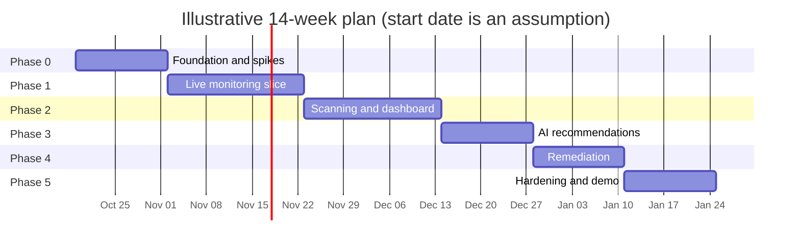
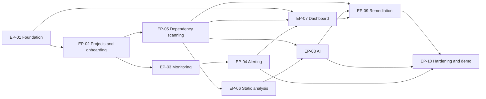

# Roadmap

> **Doc:** ROADMAP.md · **Version:** 0.2 · **Date:** 2026-10-13 · **Status:** Draft · **Related:** [PRD](PRD.md), [TASKS](TASKS.md), [DECISIONS](DECISIONS.md)

Assumptions (**[A]**, confirmed under DEC-016 / UD-08): a team of 4 students, 14 working weeks, 5 working days per week, focus factor \( f = 0.4 \) (~15 hours/week per student), one shared GitHub organization. The calendar start date in the chart is illustrative.

## 1. Delivery approach

1. **Spikes first.** The four unknowns that can invalidate the design (OTel→Prometheus naming, sandbox runtime, GitHub write path, Trivy/OSV output) are resolved in Phase 0 (`SP-01`…`SP-04`).
2. **Vertical slices.** Each phase ends with something demonstrable end to end, not a layer of unfinished plumbing.
3. **Safety before breadth.** Remediation is built after scanning, AI validation, and the approval model exist.
4. **Evidence of progress is measured.** Every milestone has exit criteria tied to SM-xx metrics.

## 2. Phases and milestones

| Phase | Weeks | Focus | Epics | Milestone and exit criteria |
|---|---|---|---|---|
| P0 | 1–2 | Foundation and spikes | EP-01 (start), spikes in EP-03/05/09, fixtures, demo app | **M0:** CI + Compose + login working; UD-02, UD-03, UD-06 decided; `examples/demo-app` and `examples/vulnerable-repo` exist |
| P1 | 3–5 | Live monitoring slice | EP-01 (finish), EP-02, EP-03, EP-04, UI foundation | **M1:** onboard the demo app, see charts, threshold alert fires and a webhook is delivered; SM-03 and SM-04 measured |
| P2 | 6–8 | Scanning and unified dashboard | EP-05, EP-06, EP-07 | **M2:** scan the vulnerable repo; findings explorer and overview work; partial-scan behavior demonstrated; SM-02 measured |
| P3 | 9–10 | AI recommendations | EP-08 | **M3:** validated, partially validated, and rejected outputs all demonstrable; SM-06 golden-set audit recorded |
| P4 | 11–12 | Automated remediation | EP-09 | **M4:** fix proposal validated in sandbox, approved, draft PR on the test repo; SM-05 and SM-07 verified |
| P5 | 13–14 | Hardening, Should items, demo | EP-10 + Should/Could as time allows | **M5:** acceptance suite green, usability session (SM-01), security checklist done, two clean demo rehearsals |

Phases overlap in practice because the team works in parallel streams (suggested, **[A]**): *Platform + UI* (EP-01, EP-07), *Monitoring + alerting* (EP-03, EP-04), *Scanning + static analysis* (EP-05, EP-06), *AI* (EP-08), *Remediation + security* (EP-09, EP-10).

## 3. Epic dependencies

EP-09 depends on EP-08 only for the optional LLM-patch task (`T-09.13`, Could) and for shared validator/evidence code; the *core* remediation path needs EP-05 and the approval model.

## 4. Capacity check

Capacity in person-days with focus factor \( f \) (share of a member's time that goes to this project):

\[ C = P \cdot W \cdot D \cdot f \]

where \( P \) is team size, \( W \) weeks, \( D \) working days per week. With confirmed parameters (**DEC-016**): \( P=4,\ W=14,\ D=5,\ f=0.4 \) (~15 hours/week per student):

\[ C = 4 \cdot 14 \cdot 5 \cdot 0.4 = 112 \text{ person-days} \]

Task effort uses midpoints S=1, M=2.5, L=5, XL=8 ([TASKS](TASKS.md)); these are team-estimate guesses with perhaps ±40 % uncertainty **[A]**.

| Quantity | Person-days |
|---|---|
| Must tasks (nominal full scope, 71 tasks) | 205 |
| Should tasks (16 tasks) | 22 |
| Could tasks (5 tasks, not committed) | 13.5 |
| Capacity, \( P=4, f=0.4 \) (**confirmed**) | 112 |
| Capacity, \( P=4, f=0.5 \) | 140 |
| Capacity, \( P=5, f=0.5 \) | 175 |

**Finding:** With \( P=4 \) and \( f=0.4 \), the **nominal Must scope exceeds available capacity** (\( 205 / 112 \approx 1.83 \)). Therefore, the team actively operates under the **scope-cut ladder** in §5:
1. All Should and Could tasks are excluded from baseline commitments.
2. The core end-to-end slice focuses on **npm** for dependency scanning and automated remediation; PyPI remediation pipeline (`T-09.06`) is deferred.
3. Secondary evaluation scripts and non-critical spikes are streamlined.

Per-phase load against capacity (\( P=4, f=0.4 \), total 112 person-days):

| Phase | Weeks | Capacity (\( P=4, f=0.4 \)) | Nominal Must load | Adjusted Must load (with cuts) |
|---|---|---|---|---|
| P0 | 2 | 16 | 36 | 18 |
| P1 | 3 | 24 | 40.5 | 24 |
| P2 | 3 | 24 | 49.5 | 25 |
| P3 | 2 | 16 | 22 | 15 |
| P4 | 2 | 16 | 40.5 | 18 |
| P5 | 2 | 16 | 16.5 | 12 |

Mitigation: start later-phase tasks that have no dependency early (for example the evidence-pack and redaction work, `T-08.01`/`T-08.02`, can begin in P2), keep PyPI remediation behind the scope-cut flag, and prioritize npm full-flow demonstration.

## 5. Scope-cut ladder

Apply in order when the burn-up chart (completed Must person-days against plan) is behind by more than 10 % at a milestone. Savings use the midpoint estimates.

| Step | Cut | Saves | Cumulative saving | Consequence |
|---|---|---|---|---|
| 0 | Drop all Should/Could tasks | (not counted above) | 0 | Already excluded from the Must load |
| 1 | Remediation for npm only; defer PyPI pipeline `T-09.06` | 5 | 5 | SM-05 demonstrated for npm only |
| 2 | Use Trivy only; defer OSV adapter `T-05.06` (revise DEC-006) | 5 | 10 | Single advisory source; weaker cross-check; FR-DEP-03/04 partly met |
| 3 | Defer performance scripts `T-10.03` | 2.5 | 12.5 | NFR-PERF-01/02/03 reported as "not measured" |
| 4 | **Plan-only remediation:** keep proposals, diffs, approval, and PR creation but skip sandbox execution (`T-09.03`, `T-09.05`, `T-09.07`) | 15.5 | 28 | FR-REM-02, 04, 05 unmet; every proposal is `unverified` and needs acknowledgment; SM-05 cannot be claimed. Use only if UD-03 fails. |

Steps 1–3 save 12.5 person-days; step 4 brings the total to 28, roughly the gap at \( f=0.5 \). Steps are decisions for the team and must be recorded in `DECISIONS.md`.

## 6. Recommended implementation sequence

1. **Confirmed team size (4 members) and calendar (14 weeks, f=0.4, UD-08 / DEC-016 resolved); created repo scaffold and CI pipeline (`T-01.01` completed);** Compose skeleton and baseline DB next (`T-01.02`–`T-01.03`).
2. Run the four spikes in parallel (`T-03.02`, `T-05.02`, `T-09.01`, `T-09.02`) and decide UD-02, UD-03, UD-06; build the demo app and vulnerable-repo fixture.
3. Finish auth, RBAC, job queue, logging, secret encryption, safe subprocess/HTTP helpers.
4. Deliver the monitoring and alerting slice (M1), including the detection-time test.
5. Deliver scanning, static analysis, and the findings/overview UI (M2).
6. Deliver the evidence-grounded AI path with the golden set (M3).
7. Deliver remediation behind `REMEDIATION_ENABLED` and the approval model (M4).
8. Harden, test, measure, document, rehearse (M5).

## 7. Risk register

Likelihood (L) and impact (I): L/M/H. Ratings are the author's judgment **[A]**.

| ID | Risk | L | I | Mitigation | Early-warning trigger |
|---|---|---|---|---|---|
| R-01 | Must scope exceeds team capacity (see §4) | H | H | Cut ladder; weekly burn-up; start independent tasks early | Milestone slips > 10 % |
| R-02 | Sandbox runtime infeasible or unsafe on team machines | M | H | Phase 0 spike on every OS; plan-only fallback | SP-02 fails on any common platform |
| R-03 | OTel→Prometheus metric/label names or staleness differ from design | M | M | SP-01; all queries confined to `monitoring/queries.py` | Charts empty in SP-01 |
| R-04 | Validator misses a class of unsupported AI claim | M | H | Golden set incl. seeded-bad outputs; two-person audit; strict `validated` rule | Audit finds an unsupported claim marked `validated` |
| R-05 | Indirect prompt injection or a recommended package that exists but is untrustworthy | M | H | Evidence-only context, no tools, escaping, UI warning "existence ≠ trust", registry-age and release-history criteria | Injection fixture changes output semantics |
| R-06 | External APIs rate-limit or change (OSV, registries, GitHub, Anthropic) | M | M | Backoff, caches, recorded fixtures, `partial` status, cached demo data | Increased provider `failed` rate |
| R-07 | Semgrep rule-license misuse | L | M | Record UD-01 decision; internal use only; no hosted service | Plan to offer a public hosted instance |
| R-08 | Flaky or slow repository tests make fix validation unreliable | H | M | Timeouts; baseline comparison; `unverified` state rather than pass | Baseline instability on fixture |
| R-09 | Credential leakage (PAT, API keys) via logs, responses, or prompts | L | H | Encryption, redaction filter, response/log scanning tests | Any secret found by test |
| R-10 | Team availability (exams, illness) | H | M | Pairing on critical path, documented ownership, small tasks | Two missed standups |
| R-11 | Demo environment failure | M | M | Rehearsals, recorded fallback, seeded data | Rehearsal failure |
| R-12 | Trivy and OSV disagree, confusing users | M | L | Provenance shown; merge by alias set; document disagreement handling | User confusion in usability session |
| R-13 | Monitored apps lack the HTTP server duration metric, so charts stay empty | M | M | Clear empty state with instructions; demo app as reference; scrape mode (Should) | Onboarding test stalls at "waiting" |

## 8. Highest-risk assumptions (prioritized)

1. **Capacity matches scope** (AS-05/UD-08): the Must load is estimated at 205 person-days against 175 available.
2. **A safe isolated container runtime is available** on all team machines (AS-03/UD-03).
3. **OTel→Collector→Prometheus produces stable metric and label names** and acceptable staleness behavior (UD-06).
4. **Target applications emit the HTTP server request-duration histogram** with status-code attributes (AS-01).
5. **Repositories have tests that can run offline after dependency installation** (AS-02); otherwise most proposals are `unverified`.
6. **The AI validator can catch fabricated packages, versions, and unsupported compatibility claims** with mechanical checks only (NFR-AI-01).
7. **Public APIs and databases stay available and compatible** during the term (AS-04).
8. **Semgrep rule licensing fits a self-hosted course project** (UD-01; not legal advice).

## 9. Post-MVP extensions (not committed)

| Extension | Notes |
|---|---|
| Traces and logs ingestion | Needs trace/log backends and a correlation UI; correlation must stay evidence-based. |
| GitHub App authentication | Better least-privilege and rotation than PATs (UD-02). |
| Additional ecosystems and Git hosts | Each needs parser, registry adapter, sandbox pipeline. |
| Per-target ingest tokens, per-project roles, SSO | Lifts DEC-013/DEC-014 limits. |
| Alertmanager integration, silencing | FR-ALR-07 and richer routing. |
| LLM-generated patches through the validation pipeline | FR-REM-11, only with the same gates. |
| Reachability analysis for vulnerable code paths | Would reduce false urgency; research-level effort. |
| SBOM export, scheduled digests, dashboards for trends | Uses data already stored. |
