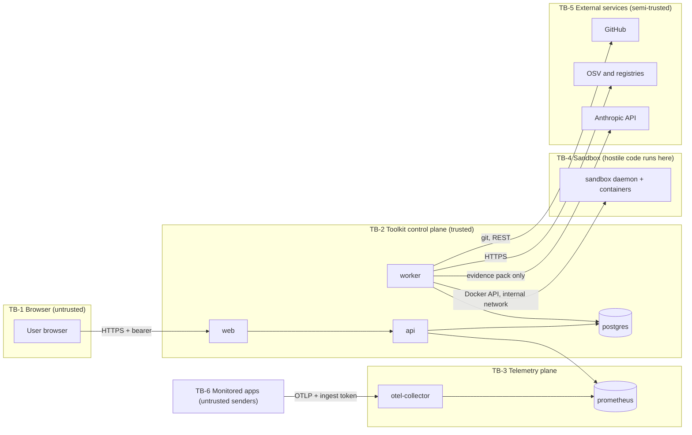

# Security

> **Doc:** SECURITY.md · **Version:** 0.2 · **Date:** 2026-10-13 · **Status:** Draft (**[P]** unless marked) · **Related:** [SRS §6](SRS.md#6-non-functional-requirements), [ARCHITECTURE](ARCHITECTURE.md), [AI_DESIGN](AI_DESIGN.md), [DATA_MODEL §8](DATA_MODEL.md#8-sensitive-data-handling)

## 1. Security objectives

| ID | Objective |
|---|---|
| SO-01 | Only authenticated, authorized users can read data or trigger actions. |
| SO-02 | Credentials (repository tokens, API keys, ingest token) are never exposed to browsers, logs, LLM prompts, or sandboxes. |
| SO-03 | Code from scanned repositories and dependencies is untrusted and runs only inside the sandbox. |
| SO-04 | No change reaches a remote repository without a recorded human approval; nothing is merged by the Toolkit. |
| SO-05 | LLM output is untrusted data: validated, escaped, never executed. |
| SO-06 | Findings and alerts are honest: failures are visible, not hidden as "clean". |

## 2. Assets

| Asset | Why it matters |
|---|---|
| Repository tokens (GitHub PAT) | Grant read/write to the team's source code |
| Source code and snippets | May contain proprietary logic or secrets |
| Anthropic API key | Cost and data-exposure path |
| OTLP ingest token | Controls who can feed metrics |
| User accounts and sessions | Gate to all actions |
| Findings, alerts, audit log | Integrity affects decisions |
| Worker and sandbox hosts | Execute untrusted code |

## 3. Trust boundaries

Data crossing a boundary is validated at the receiving side. Content returning from TB-4, TB-5, and TB-6 is treated as untrusted input.

## 4. Threat model

STRIDE letters: **S**poofing, **T**ampering, **R**epudiation, **I**nformation disclosure, **D**enial of service, **E**levation of privilege.

| ID | STRIDE | Threat | Mitigations | Refs | Residual risk |
|---|---|---|---|---|---|
| TH-01 | S | Credential stuffing/brute force on login | Argon2id, rate limiting, uniform error message | NFR-SEC-01, NFR-SEC-04 | Low |
| TH-02 | S | Stolen access token | ≤ 15-minute lifetime; kept in memory by the SPA, not `localStorage`; role and `is_active` read from DB on every request | NFR-SEC-01 | Low–Medium |
| TH-03 | S/T | CSRF against cookie-based refresh/logout | `SameSite=Strict`, cookie path limited to `/api/v1/auth`, require a custom request header on those routes | NFR-SEC-01 | Low |
| TH-04 | E | Viewer acts as maintainer (broken access control) | Server-side role guard on every route; generated role-endpoint tests | FR-AUTH-03 | Low |
| TH-05 | I | Repository token read from the database or a backup | AES-256-GCM, `ENCRYPTION_KEY` stored apart from the DB and backups, `key_id` rotation | NFR-SEC-02 | Medium (key compromise) |
| TH-06 | I | Token leakage via logs, API responses, LLM prompts, or sandbox env | Write-only secrets, log redaction filter, tokens decrypted only in worker memory, never passed to sandbox or prompts | NFR-SEC-02, NFR-SEC-08, NFR-AI-02 | Low |
| TH-07 | S/T | Forged or replayed telemetry with a leaked ingest token (false alerts, or masking real failures) | Token rotation, network placement, Collector limits; documented as shared-secret trust (DEC-014) | FR-MON-01 | **Medium** (accepted for MVP) |
| TH-08 | D | Metric flooding or label-cardinality explosion | Collector memory limits and batching **[A: config to verify]**, Prometheus retention, capacity envelope | NFR-CAP-01 | Medium |
| TH-09 | T | PromQL injection through names/windows | Allowlisted templates; strict parameter validators; no user PromQL | IF-02 | Low |
| TH-10 | I/E | SSRF via webhook URL, scrape URL, repository URL | Scheme/host allowlists, private/loopback/link-local blocking, resolve-then-connect check, redirects limited | NFR-SEC-09 | Low–Medium |
| TH-11 | T/E | Malicious repository at clone time (hooks, submodules, symlinks, huge files) | Hooks disabled, no submodules, `file` protocol disabled, size/time caps, symlinks not followed outside workspace, ephemeral workspace | FR-DEP-01 | Low |
| TH-12 | E | Malicious dependency install scripts | Lifecycle scripts disabled; sandbox; Python wheels-only by default (§9) | FR-REM-03 | Medium |
| TH-13 | I/E | Malicious test code exfiltrates data or calls out | Network disabled during tests; no secrets in sandbox; ephemeral volumes | FR-REM-02, FR-REM-04 | Low–Medium |
| TH-14 | E | Container escape | Non-root, all capabilities dropped, no-new-privileges, default seccomp, isolated daemon, no host mounts or sockets | NFR-SEC-05 | **Medium** (kernel-level flaws cannot be excluded) |
| TH-15 | D | Fork bomb, memory or disk exhaustion | PID, memory, CPU, wall-clock, output, and disk limits; reaper for orphan containers | NFR-SEC-05 | Low |
| TH-16 | T/E | Prompt injection via repository text, advisories, package descriptions, scanner output | §10 controls; no tools; schema + validator; human review | FR-AI-11 | Medium |
| TH-17 | T | Hallucinated or malicious package recommended (typosquat/"slopsquat") | Registry existence check **plus** metadata criteria (first release, last release, license, repository URL); UI states that existence is not trust; human decision | FR-AI-04, FR-AI-07 | **Medium** |
| TH-18 | I | Source snippets sent to a third-party LLM | Evidence-only pack, redaction, snippet bounds, `AI_ENABLED` switch, explicit notice when enabling | NFR-AI-02, FR-AI-06 | Medium (inherent to using a hosted LLM) |
| TH-19 | E | Push or PR without approval | DB CHECK linking approval to state; `pr_creation` job requires `approved`; adapter has no merge method | FR-REM-06, FR-REM-07, SM-07 | Low |
| TH-20 | T | Overwriting or deleting branches not created by the Toolkit | Adapter creates new refs only, rejects names outside `^toolkit/fix/[0-9a-f]{8}-[0-9a-f]{4}-[0-9a-f]{4}-[0-9a-f]{4}-[0-9a-f]{12}$`, never force-pushes | FR-REM-07, FR-REM-10 | Low |
| TH-21 | T/I | XSS through LLM output, advisory text, code snippets, package metadata | Render as escaped text; no raw HTML injection APIs; sanitized Markdown subset if used; strict CSP | NFR-SEC-06 | Low |
| TH-22 | E | Vulnerable dependencies in the Toolkit itself | CI Trivy/Semgrep on own repo, lockfiles, pinned versions | NFR-SEC-07 | Low–Medium |
| TH-23 | R | Audit log tampering or missing evidence of approvals | Append-only convention, no update/delete endpoints, DB role without `UPDATE`/`DELETE` on `audit_log` **[P]** | FR-AUTH-04 | Low |
| TH-24 | D | Abuse of scans or AI jobs to exhaust resources or budget | One active scan per project, AI daily cap and size limits, job concurrency limits | FR-AI-10, NFR-CAP-01 | Low |
| TH-25 | E | Insecure defaults (default admin, exposed Prometheus/sandbox) | No default credentials (bootstrap required), only needed ports published, Prometheus published in development only | NFR-SEC-03 | Low |
| TH-26 | I | Unprotected backups | Encrypt backups; keep `ENCRYPTION_KEY` out of them | NFR-DATA-02 | Medium |
| TH-27 | T | Compromised scanner binaries or runner images | Pin versions, verify checksums/signatures where published **[A]**, build runner images from minimal bases | NFR-SEC-07 | Medium |

## 5. Authentication and sessions

| Topic | Design |
|---|---|
| Passwords | 12–128 characters; Argon2id with parameters set from current OWASP guidance at implementation time **[A]**; no composition rules, but common-password check (Should) |
| Access token | JWT signed with `SECRET_KEY`; claims `sub`, `jti`, `exp` (≤ 15 min); held in SPA memory |
| Refresh | Opaque random token, stored hashed; `HttpOnly; Secure; SameSite=Strict` cookie; rotated on every use; reuse of a rotated token revokes all of that user's sessions |
| Logout / deactivation | Revokes sessions; deactivated users fail on the next request because `is_active` is read from the database |
| Bootstrap | First admin from `ADMIN_BOOTSTRAP_*`; the variables must be removed after first start (documented in DEPLOYMENT) |
| Transport | TLS required when `APP_ENV=production`; HSTS from the reverse proxy |
| Web hardening | CSP, `X-Content-Type-Options`, frame denial, CORS allowlist limited to the web origin |

## 6. Authorization

Three global roles (DEC-013). Enforcement is server-side in one dependency applied to every route; the role-endpoint matrix in [API_SPEC §7](API_SPEC.md#7-roleendpoint-summary-test-oracle-for-fr-auth-03) is the test oracle. Object-level checks: every resource ID is resolved through its project; IDs from the URL are never trusted to imply access. Sensitive actions require `maintainer` or `admin` and write an audit row (FR-AUTH-04).

### 6.1 Operational Endpoints and Network Exposure

Operational routes adhere to explicit network exposure rules verified by the CI route inventory test:
- `/health` and `/ready` are public operational probes that reveal no sensitive data.
- `/metrics` exposes Prometheus exposition metrics and is strictly designated internal (`@public_route(internal=True)`). To prevent reconnaissance and internal telemetry leakage, `/metrics` MUST NOT be exposed through any public reverse proxy or external ingress. Prometheus scrapers access `/metrics` exclusively across the private Docker/internal network (or via static scrape tokens where configured per API_SPEC §2).

## 7. Secrets management

| Secret | Storage | Rotation |
|---|---|---|
| `SECRET_KEY` | Environment / Docker secret | Rotate by restart; invalidates access tokens |
| `ENCRYPTION_KEY` | Environment / Docker secret, separate from DB backups | New `key_id`; background re-encryption; remove old key afterwards |
| `OTLP_INGEST_TOKEN` | Environment of the Collector (and shown only to admins) | Change variable, restart Collector, update monitored apps |
| `ANTHROPIC_API_KEY` | Environment of the worker only | Replace and restart worker |
| GitHub PAT | Encrypted in `credential` | User replaces it in the UI; old value overwritten |
| Webhook URL / SMTP password | Encrypted config or environment | Replace in UI or environment |

Rules: no secrets in the repository (`.env` is git-ignored; `.env.example` has placeholders only); CI runs a secret scan on the Toolkit's own repository; production-like deployments use Docker secrets or an equivalent instead of plain `.env`; secrets never appear in URLs.

## 8. Repository access (least privilege)

| Use | GitHub fine-grained PAT permissions **[A: confirm in SP-04]** | Notes |
|---|---|---|
| Scan a public repository | None (anonymous HTTPS clone) | Lower rate limits |
| Scan a private repository | Metadata: read, Contents: read | Select only the repository in question |
| Open fix PRs | Additionally Contents: read/write and Pull requests: read/write | Needed to create a branch and a PR; not needed for scanning |

Recommendations: one repository per token; expiry ≤ 90 days; use a read-only token unless remediation is needed (`can_open_prs` in the API shows what the token appears to allow); protect the default branch with required reviews so that a draft PR cannot be merged without review.

Toolkit-side limits independent of token power: the Git adapter exposes only *read metadata, clone, create branch, push to `toolkit/fix/…`, open draft PR, close PR, delete own branch*; it never force-pushes, never writes to existing branches, never touches workflow files (diff scope is manifests and lockfiles only, FR-REM-03).

## 9. Secure execution of generated changes

Remediation is the highest-risk feature. Generated changes come from **deterministic code**, never from the LLM (FR-REM-01, CON-05).

### 9.1 Pipeline controls

| Control | Requirement |
|---|---|
| Plan validation | Package names match ecosystem grammar; versions match SemVer/PEP 440; both come from stored findings and registry data, not from model output |
| Allowed commands | Fixed argument vectors per ecosystem (TRD §8); no shell; no user- or model-provided flags |
| Lifecycle scripts | Disabled for npm installs; Python installs use wheels only (`--only-binary :all:` style) **[A: exact flags verified in SP-02/T-09.06]**; a package that needs a source build makes the proposal fail with `SDIST_BUILD_REQUIRED` unless an admin explicitly allows it |
| Lockfile preservation | Only the target packages change; the lockfile format is not migrated; a diff touching anything except manifest and lockfile paths aborts (`DIFF_SCOPE_VIOLATION`) |
| Regression testing | Baseline and post-change test runs, post-change with network disabled; delta re-scan (FR-REM-04/05) |
| Reviewable diff | Full diff and validation report shown before approval (FR-REM-06) |
| Approval | Recorded user, time, acknowledgments; `failed` validation needs an admin override that is audited |
| Delivery | Draft PR on `toolkit/fix/<id>`; merge only by humans on GitHub |
| Rollback | Base SHA recorded; PR can be closed and its branch deleted by the Toolkit; post-merge rollback is a normal `git revert` |

### 9.2 Sandbox profile

| Property | Setting **[P]** |
|---|---|
| Runtime | Dedicated isolated daemon on an internal network; never the host Docker socket; no socket inside containers |
| User | Non-root with fixed UID |
| Privileges | Not privileged; all capabilities dropped; `no-new-privileges`; default seccomp profile |
| Filesystem | Read-only root; writable ephemeral workspace and tmpfs only; no host mounts |
| Resources | CPU, memory, PID limits; wall-clock timeout per stage; output cap; workspace size cap **[A: enforcement method per runtime]** |
| Environment | No Toolkit secrets, no repository tokens, no cloud metadata access |
| Network | *Install/resolve stage:* on, scripts disabled, nothing sensitive present. *Test stage:* **off**. An egress allowlist proxy for the install stage is a Should-level hardening step **[A]** |
| Lifecycle | Labeled containers; reaped at stage end and at worker start |

### 9.3 Honest limits

Containers share the host kernel; a kernel vulnerability could allow escape (TH-14). The install stage has network access, so a hostile package could try to reach the network during resolution (scripts disabled reduces but does not remove this risk). Test code from the target repository runs with whatever the sandbox permits. For these reasons: use an isolated daemon, keep the sandbox host free of secrets, document that remediation should only be enabled for repositories the team controls, and keep `REMEDIATION_ENABLED=false` available.

## 10. Prompt injection and AI-specific risks

| Content source | Trust | Handling |
|---|---|---|
| System instructions and schema | Trusted | Versioned in code |
| Repository code, comments, README | Untrusted | Snippet bounded and redacted; delimited as data |
| OSV advisory text | Third-party | Delimited as data; displayed escaped |
| Registry package descriptions | Third-party | Delimited as data; only structured fields used where possible |
| Scanner messages | Semi-trusted | Delimited as data |
| Model output | Untrusted | Schema-validated; claims checked; escaped; never executed; model-provided URLs are not rendered as links (evidence URLs come from stored records) |

Controls: (PI-01) data and instructions are separated with explicit delimiters and a fixed instruction hierarchy; (PI-02) the model has **no tools**, no network, no repository access (DEC-008); (PI-03) output must match a JSON schema with `evidence_refs`; (PI-04) package names from the model are validated against ecosystem grammar and URL-encoded before registry lookups; (PI-05) existence is not trust: alternatives show registry-derived age, release history, license, and repository URL; (PI-06) an unsupported claim never makes a recommendation `validated`; (PI-07) human review before any action; (PI-08) adversarial fixtures run in CI (FR-AI-11); (PI-09) daily cap and input-size limit (FR-AI-10); (PI-10) a user-facing notice that snippets are sent to Anthropic when AI is enabled. Details: [AI_DESIGN](AI_DESIGN.md).

## 11. Data protection, logging, audit

- Data classification and retention: [DATA_MODEL §7–8](DATA_MODEL.md#7-retention).
- Logs are structured JSON, redacted (NFR-SEC-08); request bodies of auth, repository, and notification-channel endpoints are never logged.
- Audit events: login success/failure, user changes, credential create/delete, repository connect/disconnect, scan triggers, recommendation requests, proposal creation/approval/rejection/admin override, PR creation, branch cleanup.
- The Toolkit does **not** enable Trivy secret scanning for customer repositories, so credentials in scanned code are not ingested **[V: scanner default includes secrets, so the flag is set explicitly]**.

## 12. Verification checklist (executed in `T-10.04`)

| ID | Check | Method |
|---|---|---|
| SC-01 | Every route is covered by the role-endpoint test and denies insufficient roles | Automated |
| SC-02 | No secret appears in any API response, log line, error message, or LLM request body | Automated scan of captured output |
| SC-03 | Login throttling and uniform error messages work | Automated |
| SC-04 | Refresh rotation and reuse detection revoke sessions | Automated |
| SC-05 | SSRF cases (private IPs, redirects, DNS rebinding sample) are rejected for webhook, scrape, and repository URLs | Automated |
| SC-06 | Shell metacharacters, path traversal, and option injection in package names/versions/refs are rejected | Fuzz test |
| SC-07 | Hostile-hook repository does not execute code during clone | Fixture test |
| SC-08 | Sandbox cannot read Toolkit secrets, host paths, or reach the Docker socket; limits enforced | Manual escape checklist + scripts |
| SC-09 | Tests run with networking disabled | Automated probe in sandbox |
| SC-10 | PR creation without approval returns `409`; branch names outside the pattern are refused; no merge call exists | Automated + code review |
| SC-11 | Prompt-injection fixtures do not alter validated output semantics | Golden-set run |
| SC-12 | UI renders hostile strings as inert text (XSS fixtures) | Automated browser test |
| SC-13 | CI scans the Toolkit's own dependencies and code; no unresolved `critical` | CI report |
| SC-14 | Default deployment publishes only intended ports; no default credentials | Compose review |
| SC-15 | Backups contain no plaintext secrets; restore drill done | Manual |

## 13. Residual risks and response

Accepted for the MVP: shared ingest token (TH-07), hosted-LLM data exposure (TH-18), kernel-level sandbox escape (TH-14), install-stage network access (TH-12). Response outline: **suspected secret leak** → rotate the secret, review audit log; **suspected sandbox compromise** → set `REMEDIATION_ENABLED=false`, destroy the sandbox daemon and volumes, rotate any PAT that was ever used for PR creation; **bad PR created** → close the PR and delete the branch through the cleanup endpoint. A responsible-disclosure contact is to be added to the repository once the project is public (UD-01).
