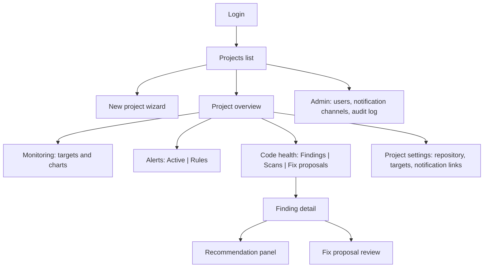

# UI/UX Specification & Design System

> **Doc:** UI_UX_SPEC.md
> **Version:** 0.4
> **Date:** 2026-10-23
> **Status:** Active Spec
> **Related:** [FRD §4.9](FRD.md#49-unified-dashboard-ep-07), [API_SPEC](API_SPEC.md), [WORKFLOW](WORKFLOW.md), [AI_DESIGN §7](AI_DESIGN.md#7-uncertainty-communication)

---

## 1. Design Intent & Principles

Operators read this at 3 a.m. and engineers read it at a desk. Design for calm under pressure: one signal at a time, nothing that moves unless it means something. The reference feel is Apple (restraint, depth through spacing and elevation, not decoration) set in Google-clean type. All rules in this document enforce the 20 cognitive and UX laws mapped in [Appendix A](#appendix-a-ux-laws-traceability).

1. **One project, two lenses.** Runtime health and repository health sit side by side in distinct common regions (`Monitoring` + `Alerts`, and `Latest scan` + `Top findings` + `Fix proposals`) with their own region headings and no causal connector.
2. **Show the evidence (Three-Tier Progressive Disclosure).** Alerts, findings, and recommendations always expose the data behind them without overwhelming the viewport:
   - **Tier 1 — Always visible:** The verdict and its core evidence (observed value vs. threshold, window, severity, status, source, timestamps). All `partial`, `unrated`, `no data`, and `no traffic` banners stay persistent and are never collapsible.
   - **Tier 2 — One click:** Full evidence list, scan history, and provider runs. Collapsed sections always display a summary line with an explicit item count (e.g., `"Evidence (3 items)"`) so hiding details never hides existence.
   - **Tier 3 — On demand:** Raw payloads, full stack traces, and unsupported AI claims.
   - **Mandatory Review Exception (`SCR-13`):** On Fix Proposal Review, the diff viewer, test report, delta scan, and risk notes are *never* collapsed so that the review checkboxes remain meaningful.
3. **Say what you don't know.** `partial`, `unrated`, `unverified`, `no data`, and `no traffic` are first-class states with their own wording; the UI never shows a green "all clear" when data is missing. Zero-counts (`0 alerts`) render in neutral text, never green.
4. **Make risky actions deliberate.** Approving a fix is a multi-step review, not one click. Cognitive friction comes from content (explicit review checkboxes, named object confirmations), never from artificial delays or cooldown timers.
5. **Calm density.** Operators scan quickly: tables with filters, compact cards, restrained color, color never the only signal.

### Responsive Tiers (IF-12)
- **Universal rule:** No page-level horizontal overflow at any viewport width (`375px` to `4K`). Layouts span the full width of the screen on desktop (`w-full`) edge-to-edge with outer padding of `24px` on mobile and `48px` on desktop, eliminating artificial desktop max-width constraints.
- **Triage Tier (Full `375px` support):** `SCR-01`, `SCR-02`, `SCR-04`, `SCR-05`, `SCR-06`, `SCR-07`, and read-only `SCR-11`. Operators can inspect, acknowledge, and resolve incidents on mobile. Cards stack vertically; alert tables collapse into summary rows (severity, title, target, last seen).
- **Desktop Tier (`≥ 1024px` primary, usable at `375px`):** `SCR-03`, `SCR-08`, `SCR-09`, `SCR-10`, `SCR-12`, `SCR-13`, `SCR-14`, `SCR-15`. At `< 768px`, wide tables and unified diffs scroll horizontally inside their own container with a sticky first column. On `SCR-13` below `768px`, the review remains readable, but **Approve** and **Admin override** are disabled with visible explanation: *"Open on a desktop (≥ 768px) to approve."*

---

## 2. Color Roles, Contrast & Isolation

- **Canvas** is true black in dark (`#000000`), porcelain white in light (`#FAFAFC`). Panels step up through `surface` (`#101014` / `#FFFFFF`) and `surface-2` (`#18181D` / `#F1F1F6`); never tint the canvas.
- **Periwinkle** (`#8E9CFF` / `#4F5BD5`) is interaction only: links, focus rings (on interactive non-input controls), selection, active tab/pill washes (`bg-peri/15 text-peri`), outline buttons (`border-peri text-peri`), checked control fills (with the checkmark drawn in `canvas`), and the primary chart series. **Filled periwinkle buttons are banned** so they never compete with the single coral CTA. Periwinkle is never used as a status or role badge color.
- **Coral** (`#FF6F61` / `#F26B5B`) is the highlight and primary action: **one solid coral fill per screen at most** (the main CTA). Coral buttons and coral surfaces always use pure white text and icons (`text-white` / `text-on-coral` `#FFFFFF`). Coral is a fill only, never body or label text.
- **Input Focus Rings:** All input fields, textareas, and select elements **do not display a focus ring** (`outline: none; box-shadow: none; ring: 0;`). Keyboard focus rings are reserved for buttons, links, and navigables.
- **Critical** (`#FF4D7A` / `#D4123F`) is reserved for incidents, critical findings, and destructive confirmation buttons, always paired with an icon and a word, never color alone.
  - **Solid vs. Tinted Isolation (Von Restorff Effect):** To prevent visual competition between the screen's single `coral` CTA and multiple `critical` findings/alerts, **100% solid fills** are restricted to the single `coral` CTA and the final confirm button inside a destructive modal (`bg-crit text-on-critical`, where `on-critical` is `#000000` in dark and `#FFFFFF` in light).
  - All status badges (`critical`, `warn`, `ok`) in tables, cards, and headers use **tinted surfaces with full-opacity text and an icon**: `bg-{status}/15 border-{status}/25 text-{status}` in dark mode, and `bg-{status}/8 border-{status}/20 text-{status}` in light mode (keeping light-mode tint at `≤ 8%` guarantees `≥ 4.5:1` contrast for `#D4123F`, `#177A32`, and `#946200` against `#FFFFFF`).
  - When a table displays many critical rows (`SCR-06`, `SCR-09`), only the top severity (`critical`) receives chroma in the severity column; lower severities use neutral chips (`bg-surface-2 text-ink-2`) with distinct icons. Newly introduced findings are isolated via a neutral `"New"` chip and heavier title weight (`font-semibold`).
- **Ok (`#30D158` / `#177A32`) / Warn (`#FFD60A` / `#946200`)** are quiet status colors used on small marks and tinted status badges, never full backgrounds or celebratory banners.
- **Contrast:** Text `4.5:1` minimum, secondary text `7:1` target, graphics `3:1`. An increased-contrast variant ships under `prefers-contrast: more`.

---

## 3. Typography & Metadata Formatting

- **Plus Jakarta Sans** for everything; **JetBrains Mono** only for code, versions, SHAs, API enums/error codes (e.g., `DIFF_SCOPE_VIOLATION`), and file paths.
- **Sentence case everywhere** (including displayed statuses like `"Ready"` and `"Passed"`); no all-caps labels.
- Display is tight (`-0.03em`), body is open (`1.55`). Line length stays under `72ch`.
- Numerals use `font-variant-numeric: tabular-nums`.
- **Hierarchy & Metadata Separators:** Hierarchy comes from size and weight, never from an arbitrary second color.
  - Default metadata runs (2–3 items) use spacing (`gap-3`) and typographic contrast (label in `text-2`, value in `text` at medium/semibold weight), never middle dots (`·`).
  - Runs of 4+ metadata items or wrapping metadata lists use a semantic list (`<ul>`/`<dl>`) with hairline vertical dividers (`border-l border-line pl-3`, `aria-hidden="true"`), never a typed pipe character (`|`).
  - Slashes (`/`) are reserved strictly for file paths and package scopes (`@scope/pkg`) in monospace.

---

## 4. Layout, Shape, Surfaces, Proximity & Fitts's Targets

### Spacing Scale & Law of Proximity
- **Strict Scale Enforcement:** All padding, gaps, and margins must come from `spacing.scale`: `[4, 8, 12, 16, 24, 32, 48, 72]` px (`p-1`, `p-2`, `p-3`, `p-4`, `p-6`, `p-8`, `p-12`, `p-18`). Off-scale utilities (`p-5`, `p-7`, `gap-5`, etc.) are banned by lint rule.
- **Rhythm & Proximity Tiers:** Macro regions and outer margins use multiples of `8px` (`24px` mobile, `48px` desktop); `4px` and `12px` are reserved for intra-component spacing. **Invariant:** The gap *between* sibling groups must always be at least one scale step larger than the gap *within* a group:
  1. *Tier 1 — Intra-component (label to value, icon to text):* `4px–8px` (`gap-1` to `gap-2`)
  2. *Tier 2 — Related peer items (form fields, metric tiles in a group, adjacent buttons):* `12px–16px` (`gap-3` to `gap-4`)
  3. *Tier 3 — Distinct Common Regions (card padding, gap between cards):* `24px` (`p-6`, `gap-6`), stepping down to `16px` (`p-4`, `gap-4`) below `768px` to protect `375px` viewports. Tables inside cards bleed edge-to-edge with `px-6` (`px-4` mobile) cell padding.
  4. *Tier 4 — Major section breaks / page margins:* `32px–48px` (`gap-8` to `gap-12`)

### Macro Asymmetry vs. Peer Similarity
- **Macro Asymmetry:** Page compositions use one dominant panel (the primary question the page answers) beside narrower supporting panels—never a row of identical cards with no hierarchy.
- **Peer Similarity:** Sibling components with the same function and data shape (metric tiles, chart panels, table rows, filter chips) must share identical border radius, padding, header structure, status-slot position, and click behavior. Size may vary to signal hierarchy; surface styling may not.

### Shape & Concentric Radii
- **Radius follows hierarchy:** Inputs `12px` (`rounded-control`), panels `20px` (`rounded-panel`), hero `28px` (`rounded-hero`), buttons, badges, chips, and segmented controls are strictly pills (`rounded-pill` / `rounded-full`, `999px`, never squircle). `rounded-control` and `rounded-panel` serve as CSS fallbacks on cards and panels; modern browsers use native squircle corners via `@toolwind/corner-shape` (`corner-squircle`).
- **Concentric radii:** An inner element's radius is its container's radius minus the padding between them, **floored at `12px` (`rounded-control`)** (so a card with `20px` radius and `24px` `p-6` padding still gives inner controls a `12px` radius). Hairline dividers inside a card (`border-line`) are permitted.

### Surfaces: Solid Cards vs. Floating Layers
- **Cards (Common Region):** Standard cards are **solid `bg-surface` with elevation shadow only—never a border or backdrop blur**:
  - **Dark mode:** `bg-surface` with `inset 0 1px 0 rgba(255,255,255,.07), 0 12px 32px rgba(0,0,0,.5)`.
  - **Light mode:** `bg-surface` with `0 1px 2px rgba(10,10,15,.05), 0 10px 30px rgba(10,10,15,.07)`.
  - **Increased contrast (`prefers-contrast: more`):** A `1px` ring (`0 0 0 1px var(--line)`) is added as the sole border exception.
- **Footer:** Solid quiet surface (`bg-footbg`) with a hairline top divider (`border-t border-line`), no blur.
- **Floating Layers (Modals, Popovers, Command Palette, Toasts, Mobile Sheet):**
  - When a floating layer opens, **the background is not blurred and does not have a dark overlay** (the underlying page content remains fully clear and un-darkened).
  - Floating dialogs and popovers use full-opacity solid `bg-surface` (`#101014`, `opacity: 1`) with elevation shadow (`shadow-card border border-line/40`). Translucent cards and frosted glass card backgrounds are prohibited.
- **Micro-interactions & Chips:** Role badges and neutral metadata chips use `bg-surface-2 text-ink-2 border border-line` (full-opacity text, never periwinkle). Button and navigation hover backgrounds use low-opacity washes with smooth CSS transitions (`duration-200 ease-out`).

### Fitts's Law & Target Sizing
- **Minimum Hit Area:** Every interactive control (buttons, nav pills, filter chips, table action icons, checkboxes, toggles) enforces a minimum hit target of **`36px × 36px` (`min-h-9`) on desktop** and **`44px × 44px` (`min-h-11`) under `@media (pointer: coarse)`**. Visual badges/controls may appear smaller if transparent padding extends the clickable hit box. Checkbox and radio text labels are always wrapped in `<label>` so the entire line is clickable.
- **Target Separation:** Adjacent interactive controls maintain at least **`8px` (`gap-2`)** separation. Opposing decision actions (**Reject** vs. **Approve** on `SCR-13`, or **Cancel** vs. **Delete** in dialogs) sit at opposite ends of their container on desktop (`justify-between`) and stack with at least **`16px` (`gap-4`)** vertical separation on narrow viewports.
- **Disabled Controls:** Disabled buttons must either display their reason in plain adjacent text (e.g., *"Tick 2 more items above to enable approval"*) or use `aria-disabled="true"` so hover/focus tooltips remain accessible (e.g., *"A scan is already running"*).

### Text Selectability & Row Interaction (Jakob's Law)
- **Content is selectable by default (`user-select: text`):** Metric values, table cells, alert descriptions, finding titles, package names, timestamps, SHAs, and evidence blocks are freely selectable for copy-pasting during incidents.
- **Chrome is non-selectable (`user-select: none`):** Applied strictly to buttons, nav pills, status badges, filter chips, segmented tabs, chart axes, and the background dot-grid. All images carry `-webkit-user-drag: none`, `user-drag: none`, and `draggable="false"`.
- **Clickable Table Rows:** Every navigable row includes a real `<a href="...">` on its primary title cell so `Cmd/Ctrl + Click` and middle-click open in a new tab. The row-level click handler checks `window.getSelection()?.toString()` and aborts navigation if the user is highlighting text.

---

## 5. Motion, Physics & Doherty Response Tiers

### Motion Primitives
- Animate `transform` and `opacity` only. Springs for interactions that follow a finger or state change; `ease-out` for reveals.
- Prefer CSS transitions (`transition-[transform,opacity,background,backdrop-filter]`) for simple state changes and button presses (`scale: 0.98`, `120ms`) where `motion/react` is not strictly necessary.
- Use `motion/react` for SVG coordinate springs and `pathLength` drawing (e.g., `MetricTile`, `LineChart`).
- One orchestrated entrance per page (`420ms`). Everything else responds directly to user interaction.
- **Perpetual animations (brand exceptions):** The baseline rule is no perpetual motion, with three explicit exceptions:
  1. **Active critical incident pulse:** Maximum **one pulsing indicator per screen**, animating `opacity` only (`0.4` to `1.0`), cycle duration `≥ 2s`, which **stops immediately once the alert is acknowledged**.
  2. **Top-bar wordmark:** `SRE + Code Health` neon glow with subtle fluorescent flicker (slow `≥ 8s` cycle with brief opacity dip).
  3. **Canvas dot-grid texture:** Interactive `20px`-pitch dot grid with subtle pointer parallax, drag pan/zoom, and pointer-reactive local dot glow highlight.
- Respect `prefers-reduced-motion: reduce`: swap springs for `0ms` transitions and disable all perpetual animations.

### Doherty Threshold (< 400ms) vs. Deliberate Friction
1. **Immediate Visual Acknowledgment (`≤ 100ms` to `400ms`):** Every click, keypress, filter toggle, or job trigger initiates visual feedback within `100ms` (button press scale, active ring) and lands a visible state transition within `400ms` (skeleton placeholder, disabled button state, or inline progress row immediately upon receiving `202 Accepted`). Background polling (`2s` / `5s` / `15s`) is data synchronization, never primary interaction feedback.
2. **Optimistic UI Updates (Low-Risk & Reversible Only):** Filter toggles, tab switches, alert acknowledgments (`SCR-06`/`SCR-07`), and finding dismissals (`SCR-09`/`SCR-10`) update the UI immediately. If the server rejects the request, roll back the state and surface a sticky error toast with the reason.
3. **Non-Optimistic & Deliberate Friction (High-Risk Actions):** Fix Proposal approvals (`SCR-13`), admin overrides, destructive actions (archive project, disconnect repo, delete rule), token saves, and `"Draft PR created"` states **never** use optimistic updates. They wait for confirmed server responses and require deliberate user verification (checkboxes or named object confirmation), without artificial timers.

---

## 6. Information Architecture, Navigation & Command Palette



### Chrome & Navigation Rules (Miller's Law & Serial Position Effect)

* **TopBar:** Sticky at the top of the page; after `8px` of scroll it becomes `70%` canvas (`bg-canvas/70`) with a `20px` blur (`backdrop-blur-xl`), `1.5x` saturation (`backdrop-saturate-150`), and a hairline bottom shadow (`shadow-[0_1px_0_var(--line)]`).
* **Left:** Clean wordmark `SRE + Code Health` (no beta pill).
* **Center (Project Navigation — capped at 5 pills):** Primary project navigation pills live exclusively in the sticky TopBar to avoid duplicate tab instances across the page:
1. **Overview** (`SCR-04`)
2. **Monitoring** (`SCR-05`)
3. **Alerts** (defaults to `SCR-06` Active Alerts; includes an in-page pill segmented control for **Active** | **Rules** `SCR-08`)
4. **Code health** (defaults to `SCR-09` Findings Explorer; includes an in-page pill segmented control for **Findings** `SCR-09` | **Scans** `SCR-11` | **Fix proposals** `SCR-12`)
5. **Settings** (`SCR-14`)

* Hover dropdown menus are banned in navigation. The parent TopBar pill (`Alerts` or `Code health`) remains visually active (`bg-peri/15 text-peri`) across all its child routes (`SCR-06..13`).

* **Right:** Search trigger pill (`Ctrl+K` on Windows, `⌘K` on macOS, hidden on mobile), the screen's single primary coral CTA (omitted on screens like `SCR-13` where the primary coral CTA lives in the workspace), and the Profile menu (which houses **Admin** `SCR-15` for Admin roles).
* **Narrow screens (`< 768px`):** Project nav pills and secondary actions fold into a **Menu** pill that opens a clean popover preserving the exact 5-group hierarchy without background blur or darkening.

* **Command Palette:**
* Clicking the TopBar search pill or pressing `Ctrl+K` / `⌘K` opens a modal combobox dialog with transparent background (no blur or dark overlay).
* **Empty state (Recognition over Recall):** Displays the last 5 recent items/searches (stored locally per device with a `"Clear"` action).
* **Results:** Grouped into **Navigate**, **Projects**, **Findings**, and **Alerts** (maximum 5 results per group). Inside a project context, results default to the current project with an `"All projects"` toggle pill.
* **Keyboard & Resilience:** `↑`/`↓` navigates, `Enter` opens, `Cmd/Ctrl + Enter` opens in a new tab, `Esc` closes only the topmost layer. API queries debounce at `150ms` and render content-shaped skeleton rows (never spinners). If the search API is unreachable, static navigation commands still function. All results strictly respect user role permissions.


* **Breadcrumbs:** Appear only at depth two or more (e.g., *Projects › demo › Code health › Findings › finding-id*). The last item is plain text with `aria-current="page"`.
* **Footer:** Full-width solid quiet surface (`bg-footbg`), `12px` text (`text-ink-2`), hairline top border (`border-t border-line`), three link columns, a hairline divider, then small print and legal links. No marketing copy.

---

## 7. Screens (SCR-01 to SCR-15)

| ID | Screen | Tier | Purpose | Key content | Primary actions (min role) | FRs |
| --- | --- | --- | --- | --- | --- | --- |
| SCR-01 | Login | Triage (`375px`) | Authenticate | Email, password, error message | Sign in (Coral Pill) | FR-AUTH-02 |
| SCR-02 | Projects list | Triage (`375px`) | Entry point | Cards/rows: name, health summary (open alerts, last scan status), archived toggle | New project (M) | FR-PRJ-01 |
| SCR-03 | New project / onboarding wizard | Desktop (`≥1024px`) | UC-01 | Steps: details → repository (optional) → monitoring target (optional) → snippet → connection status receipt | Verify repository, copy snippet (M) | FR-PRJ-01..04 |
| SCR-04 | Project overview | Triage (`375px`) | Unified view (WF-07) | Two common regions: Runtime Health (Monitoring dominant card + Alerts card) & Code Health (Latest scan, Top findings, Open fix proposals); each card has its own status | Run scan (M), drill down | FR-DSH-01, FR-PRJ-05 |
| SCR-05 | Monitoring | Triage (`375px`) | Target list and detail | Status badge, last seen, 4 peer charts (request rate, error ratio, latency p50/p95/p99), range selector (`15m`, `1h`, `6h`, `24h`), UTC/Local toggle, alert timeline | Edit target (M) | FR-MON-02, FR-PRJ-04 |
| SCR-06 | Alerts list | Triage (`375px`) | Triage | Segmented nav (Active | Rules), filters (status, severity, target), sort by last seen, non-reflowing `"N new — Show"` pill | Acknowledge, resolve (M) | FR-DSH-04 |
| SCR-07 | Alert detail | Triage (`375px`) | Evidence | Rule, status timeline, fixed alert-window evidence (query name, observed value, threshold, window), guidance text, deliveries | Acknowledge, resolve (M) | FR-ALR-04 |
| SCR-08 | Alert rules | Desktop (`≥1024px`) | Configure | Segmented nav (Active | Rules), table + form (type, metric, comparator, threshold, window, duration, severity, guidance) with unit normalization echo | Create/edit/disable (M) | FR-ALR-01 |
| SCR-09 | Findings explorer | Desktop (`≥1024px`) | Browse | Segmented nav (Findings | Scans | Fix proposals); inline filters (Search, Severity, Status) + `"More filters (N)"` pill (Type, Change, Package, File); removable active filter chips; sortable table | Open finding, bulk-select for fix proposal (M) | FR-DSH-02 |
| SCR-10 | Finding detail | Desktop (`≥1024px`) | Understand one finding | Header (title, severity or `"unrated"`, status, sources), subject, advisory block, tiered evidence list, scan history, AI recommendation panel, Fix proposals panel | Dismiss (M), Request recommendation (M), Create fix proposal (M) | FR-DSH-03, FR-AI-01, FR-REM-01 |
| SCR-11 | Scans list / detail | Triage (Read) / Desktop | Progress and provenance | Segmented nav, determinate/stage progress, commit SHA (7-char display, 40-char copy), provider runs, summary receipt counts, DB freshness info | Start scan, cancel (M) | FR-DEP-07, FR-DSH-05 |
| SCR-12 | Fix proposals list | Desktop (`≥1024px`) | Track | Segmented nav, status, packages, validation result, PR link | Open | FR-DSH-05 |
| SCR-13 | Fix proposal review | Desktop (`≥1024px` to approve) | Decide | Change table, always-visible unified diff viewer, baseline vs. post-change test report, delta scan, risk notes, acknowledgment checkboxes, approval action bar | Approve (Coral), reject (M); admin override for `failed` (A) | FR-REM-06, 09, 12 |
| SCR-14 | Project settings | Desktop (`≥1024px`) | Manage | Repository connection (write-only token), test command, target list, danger zone (archive) | Verify, disconnect, archive (M) | FR-PRJ-02 |
| SCR-15 | Admin | Desktop (`≥1024px`) | Operate | Users and roles, notification channels (live test button with delivery receipt), audit log | Create user, test channel (A) | FR-AUTH-01, FR-ALR-05, FR-AUTH-04 |

---

## 8. State Matrix, Goal Gradient & Peak-End Receipts (FR-DSH-06)

Every data view implements these states with the exact wording below. Components share one loading (skeleton), empty, and error primitive set.

### Procedural Progress & Peak-End Rules

* **Goal Gradient (Procedural Workflows Only):** Progress indicators are restricted to `SCR-03` (Onboarding Wizard), `SCR-11` (Scan execution), and `SCR-13` (Fix validation & PR creation stages). Progress bars are determinate **only** when backed by real step completion; otherwise, display the active stage name plus live elapsed time (`"Running sandbox tests · 18s"`). Fake progress percentages are banned.
* **Peak-End Receipts:** Completion states and terminal error states act as factual receipts—never celebratory confetti, hero checkmarks, or green `"All clear"` banners:
* **Onboarding (`SCR-03`):** Summary receipt listing verified vs. pending items (e.g., *"Repository verified (github.com/org/repo). Monitoring: waiting for first sample."*).
* **Scan (`SCR-11`):** Summary counts by severity plus per-provider duration and outcome.
* **Fix Approval (`SCR-13`):** PR link, branch name (`toolkit/fix/<uuid>`), base SHA, and the explicit notice: *"Draft pull request created. Review and merge it on GitHub; the Toolkit does not merge."*
* **Errors (All Views):** Every error state ends with a concrete next step (Retry button, configuration link, or CLI hint) and a selectable `Request ID` in monospace.


| View | Loading | Empty | Error | Special states |
| --- | --- | --- | --- | --- |
| Overview cards | Skeleton per card (content-shaped) | Monitoring: `"No monitoring target yet. Add one to see live metrics."` Scan: `"No scan yet. Run the first scan."` | Card-level message with retry + Request ID; other cards unaffected | Monitoring `stale`: `"No samples received for N minutes."` Scan `partial`: persistent banner naming failed providers |
| Charts | Skeleton + axes | `no_data`: `"No samples for this service yet. Check instrumentation."` `no_traffic`: `"The service reported no requests in this range."` | `"Metrics store unreachable"` + retry (503) + Request ID | Never draw a flat 100% line for no traffic |
| Alerts list | Row skeletons | `"No alerts. This does not prove the service is healthy; it means no rule is currently breached."` | Retry with Request ID | Incoming alerts while viewing show a `"N new — Show"` pill above the table without reflowing rows under the pointer |
| Findings explorer | Row skeletons | Filters active: `"No findings match these filters."` + `"Clear all filters"` action. No scan: `"Run a scan to see findings."` Clean scan: `"No findings in this scan."` | Retry with Request ID | Partial scan: persistent banner `"Results may be incomplete: osv failed."` |
| Finding detail | Section skeletons | Recommendation: `"No recommendation requested."` Proposals: `"No fix proposal."` | Per-section error + Request ID | `unrated` severity badge with tooltip `"The source provided no severity."` |
| Recommendation panel | Content skeleton with pulse | — | `"AI unavailable"` (`AI_DISABLED`/`AI_BUDGET_EXCEEDED`/job failure) with reason | `rejected`: collapsed output with explanation and item count |
| Fix review | Stage list with determinate step bar or elapsed timer | — | Failure reason per stage (`DIFF_SCOPE_VIOLATION`, `SANDBOX_UNAVAILABLE`, `TESTS_FAILED`, `SDIST_BUILD_REQUIRED`) + next step | `unverified` and `failed` persistent banners; approve button state per approval matrix |
| Jobs / scans | Inline progress row (appears `< 400ms` after `202`) | — | Error summary, `"View details"`, Request ID | `cancelled`, `partial` |

---

## 9. Key Interactions, Context Persistence, Input Parsing & Feedback Loops

### Context Persistence & Recognition over Recall

* **Time Range & Timezone (`SCR-05`, `SCR-07`):**
* The selected monitoring range (`?range=15m|1h|6h|24h`) lives in the URL and is remembered per project in `sessionStorage` when switching TopBar tabs.
* On `SCR-07` (Alert Detail), the evidence chart window is locked to the alert's evaluation window and explicitly labeled; clicking `"Back to monitoring"` restores the operator's previous `?range=`.
* Timezone defaults to `Local` with a persistent `UTC | Local` segmented toggle beside time controls. Chart axes always display the active zone label (`UTC` or local offset), and hovering any timestamp shows both `UTC` and `Local` in tabular numerals.


* **Filters & Search (`SCR-09`):**
* Inline filter bar exposes only **Search** (plain-text matching across package, file, and advisory ID), **Severity**, and **Status**. Secondary dimensions (**Type**, **Change**, **Package**, **File**) live inside a `"More filters"` pill displaying an active count badge (`"More filters (2)"`).
* All active filters and sort order persist in the URL query string and render as removable pills alongside a `"Clear all"` action.
* Focusing the search input reveals the 5 most recent searches (with a clear button) and live autocomplete suggestions for package names, file paths, and advisory IDs—requiring zero query-syntax recall.


### Postel's Law (Liberal Input Parsing, Canonical Output)

* **Sanitization on Paste & Blur:** Automatically trim leading/trailing whitespace and strip accidental line breaks or zero-width characters on paste and blur for tokens, repository URLs, commit SHAs, and emails. **Never** trim password fields, and **never** block paste on any input.
* **Flexible Repository Input (`SCR-03`, `SCR-14`):** Accept `org/repo`, `github.com/org/repo`, full HTTPS URLs (with or without `.git`, trailing slashes, or `/tree/...` paths), and SSH strings (`git@github.com:org/repo.git`). Normalize immediately and echo the canonical target below the field (`"Will connect to github.com/org/repo"`) before the user clicks **Verify**.
* **Human-Friendly Alert Rules (`SCR-08`):** Duration inputs accept `5m`, `300s`, or `1h30m` and echo the canonical value inline (`"= 5 minutes (300 s)"`). Ratio thresholds accept both `5%` and `0.05`. If a user enters an ambiguous bare integer like `5` on a ratio metric, do not guess—display an inline one-click suggestion: *"Did you mean 5% (0.05)?"*
* **Canonical Output:** Always transmit and render canonical units (integer seconds, base units, UTC ISO-8601 strings on the wire). Truncated commit SHAs render as 7 monospace characters with a copy button that copies the full 40-character SHA.

### Closed Feedback Loops & Live Counters

* **Three-Part Action Loop:** Every state-mutating user action completes three steps:
1. **Immediate inline update** (`< 400ms`).
2. **Visible audit attribution** rendered inline wherever the entity appears (e.g., *"Acknowledged by @alex 2m ago"* or *"Dismissed as false positive by @sam — 'Covered by WAF'"*).
3. **Live counter reconciliation** across badges and summary headers.


* **Immediate Commit + Compensating Undo:** Reversible actions (alert acknowledge, finding dismissal) commit immediately to the server so closing the browser tab never loses work. The `6s` undo toast triggers a compensating revert request, recording both actions in the audit log. Destructive actions never use undo toasts; they require upfront confirmation and render a persistent completion receipt. Error toasts are sticky until dismissed.
* **TopBar Alert Counter & Polling:**
* The TopBar `Alerts` pill badge displays the count of **unacknowledged firing alerts** for the active project (capped at `99+`; hidden or neutral when `0`).
* Local acknowledge/resolve actions decrement the badge immediately and reconcile with the server.
* A single per-project summary hook polls every `15s` while the tab is visible (`document.visibilityState === 'visible'`), pauses when hidden, refetches immediately on window focus, and applies exponential backoff on network errors (designed as a single hook so SSE/WebSocket can drop in later without UI changes).
* **Staleness honesty:** If the summary poll is `> 60s` stale due to network or server failure, replace confident badge numbers with a subtle stale indicator (`"Stale · 2m ago"`) rather than showing outdated counts as fresh.


### Standard Interaction Reference

| Interaction | Behavior |
| --- | --- |
| Job polling | After a `202`, the UI immediately (`< 400ms`) shows an inline progress row and polls `GET /jobs/{id}` (`2s` for `30s`, then `5s`); stops at terminal state; survives page navigation |
| Triggering a scan | Button uses `aria-disabled="true"` while active; tooltip and adjacent caption explain `"A scan is already running"` |
| Dismissing a finding | Dialog requires reason (`false positive` / `accepted risk` / `won't fix`) and optional note; commits immediately; row shows `"Dismissed"` + attribution with a `6s` compensating undo toast |
| Requesting a recommendation | Kind selector limited to valid combinations (API_SPEC §5.8); notice on first use: *"The finding's evidence, including a short code snippet where relevant, is sent to Anthropic's API."* |
| Recommendation display | Badge (**Validated**, **Partially validated**, **Rejected**), `"AI-generated, advisory"` label, claims list with evidence chips, unsupported claims collapsed behind `"Show unsupported claims (N)"`, limitations, confidence with `"not a probability"` tooltip |
| Creating a fix proposal | Multi-select eligible findings; summary of planned package changes before submitting |
| Approving a fix | See Section 10 below |
| Alert acknowledgment | One click; commits immediately; shows who and when inline; `6s` compensating undo toast; decrements TopBar counter |
| Notification channel test (`SCR-15`) | Non-optimistic: shows inline testing state, then renders actual server delivery result with timestamp (`"Delivered at 14:02:11 UTC"` or failure reason) |
| Destructive actions | Archive, disconnect repository, delete rule, close PR branch: modal dialog naming the object; initial focus lands on **Cancel**; pressing `Enter` never auto-confirms; `Esc` closes |
| Secrets | Token fields are write-only: auto-trimmed on paste; after saving, show `"Token stored"` and a replace action; never show a masked fragment |
| Copy snippets & SHAs | Copy button with confirmation toast; truncated SHAs copy the full 40-character string |

---

## 10. Fix Proposal Review and Approval Flow (`SCR-13`)

```text
┌ Fix proposal   3 packages   base commit 1a2b3c4 ─────────── Status: Ready ┐
│ Validation: Passed   Baseline tests: passed (42 s)   After change: passed │
│ Delta scan: 2 findings resolved   0 new                                   │
├ Changes ──────────────────────────────────────────────────────────────────┤
│ example-pkg   1.2.3 → 1.2.9   patch   package.json, package-lock.json     │
├ Diff ─────────────────────────────────────────────────────────────────────┤
│  (unified diff viewer, always expanded, limited to manifests & lockfiles) │
├ Risk notes ───────────────────────────────────────────────────────────────┤
│  • Transitive dependency updated; lockfile-only change                    │
├ Approval ─────────────────────────────────────────────────────────────────┤
│  [ ] I reviewed the diff and test report                                  │
│  [ ] (if unverified) I understand tests were missing or failing at base   │
│  [ ] (if major bump) I understand this may break compatibility            │
│                                                                           │
│  Tick all applicable items above to enable approval.                      │
│  [Reject]                              [Approve and open draft PR]        │
└───────────────────────────────────────────────────────────────────────────┘

```

Rules:

* **No Collapsing:** The Changes table, Diff viewer, Test report, Delta scan, and Risk notes are never collapsible on `SCR-13`.
* **Action Bar & Fitts's Law:** **Approve and open draft PR** is the screen's single `primary` coral pill (`bg-coral text-on-coral`), placed directly below the checkboxes (never sticky or floating). The TopBar carries no coral CTA on `SCR-13`. **Reject** is a `secondary` outline pill placed at the opposite end of the action bar (`≥ 16px` vertical gap when stacked).
* **Deliberate Gating:** The Approve button stays disabled until all *applicable* checkboxes are ticked, with plain text beside/above the button stating how many items remain (`"Tick 2 more items above to enable approval"`). Below `768px`, Approve is disabled with `"Open on a desktop (≥ 768px) to approve."`
* **Admin Override:** For `validation.result = failed`, only admins see `"Approve (admin override)"` with a mandatory justification comment field.
* **Peak-End Receipt:** After server confirmation, the page displays the PR job stage and final receipt: *"Draft pull request created. Review and merge it on GitHub; the Toolkit does not merge."* alongside the clickable PR link, branch name pattern (`toolkit/fix/<uuid>`), and base SHA.

---

## 11. Data Visualization & Chart Standards

Chart colors follow the unified palette:

* **Hybrid palette:** Primary series uses periwinkle (`c1`), context series use the neutral ramp (`text-2`), and categorical hues (`c2` to `c5`) appear only when a chart has three or more series (maximum 5 series per chart).
* **Redundant encoding:** Color is never the only signal:
* Each series has a direct end label and its own stroke dash pattern (`DASH`: `none`, `7 4`, `2 4`, `9 3 2 3`, `1 5`).
* Uptime status bars change height as well as color (`ok`: `28px`, `degraded`: `17px`, `down`: `8px`).
* Exact values are rendered, not merely implied.


* **Apple Charting Data:** Data is the loudest element; axes stay quiet and always label the active timezone (`UTC` or local offset); gridlines are few; people can hover/scrub for exact values in both `UTC` and `Local`.
* **Heatmaps:** Step periwinkle lightness against the surface (`color-mix(in srgb, var(--c1) ..., var(--surface-2))`), showing exact values on hover.

---

## 12. Component Primitives Set

1. **Button (`components/ui/button.tsx`):**
* Hit target: `min-h-9` (`36px`) desktop, `min-h-11` (`44px`) under `@media (pointer: coarse)`. `user-select: none`.
* `primary`: Coral fill (`bg-coral text-on-coral font-semibold`), pill shape, max 1 per screen.
* `halo`: CSS-only glowing halo variant using `@property --a` and `conic-gradient()` animation with `text-on-coral`, reserved for the primary `'New project'` CTA on `SCR-02`.
* `secondary`: Periwinkle outline (`border border-peri text-peri hover:bg-peri/10`), pill shape. (Filled periwinkle buttons are banned.)
* `destructive`: Solid critical fill (`bg-crit text-on-critical font-semibold`), pill shape, used **only** inside destructive confirmation dialogs.
* `ghost`: Quiet text (`text-ink-2 hover:text-ink hover:bg-surface-2/60`), pill shape.


2. **StatusBadge (`components/ui/status-badge.tsx`):**
* Icon + Word + Tinted surface (`user-select: none`). Never solid fill.
* Dark mode: `bg-{status}/15 border border-{status}/25 text-{status}`.
* Light mode: `bg-{status}/8 border border-{status}/20 text-{status}` (enforces `≥ 4.5:1` contrast).
* Variants: `critical` (`text-crit`), `warning` (`text-warn`), `healthy` (`text-ok`), `neutral` (`bg-surface-2 text-ink-2 border-line`).


3. **Card (`components/ui/card.tsx`):**
* Solid borderless elevated container: `rounded-panel corner-squircle bg-surface p-6 max-md:p-4 shadow-card` (plus `1px` `var(--line)` ring under `prefers-contrast: more`). Never apply `backdrop-blur` or default borders to cards.


4. **Skeleton (`components/ui/skeleton.tsx`):**
* Content-shaped shimmer placeholder (`skeleton-shimmer corner-squircle`) using an angled linear-gradient and CSS translate animation, replacing circular spinners everywhere.


5. **MetricTile (`components/metrics/metric-tile.tsx`):**
* Peer-consistent layout: metric label (`text-2`), tabular numeral value (`user-select: text`), delta tag, and 7-point SVG trace.


6. **Charts (`components/charts/`):**
* `LineChart`, `BarChart`, `UptimeStrip`, `Heatmap`.


7. **Layout (`components/layout/`):**
* `TopBar` (sticky, translucent `bg-canvas/70 backdrop-blur-xl` on scroll, wordmark, 5 project nav pills, `⌘K` search pill, primary action, profile menu).
* `CommandPalette` (`⌘K` / `Ctrl K` modal combobox with recents, scoped search, and keyboard navigation).
* `SegmentedNav` (in-page pill switcher for `Alerts` and `Code health` sub-views).
* `Breadcrumbs` (accessible hierarchy at depth `≥ 2`).
* `Footer` (solid `bg-footbg`, `border-t border-line`, link columns, legal).


---

## 13. Banned Patterns (The AI-Slop List)

* Purple-to-blue gradient heroes, gradient text, glow orbs, blurred background blobs.
* Glassmorphism (`backdrop-blur`) or borders on standard cards or footers (reserved strictly for floating layers: scrolled TopBar, modals, popovers, toasts, and mobile bottom sheet).
* Filled periwinkle buttons, or white text on coral fills (always use `text-on-coral`).
* Solid-fill status badges in tables or cards (use `15%` dark / `8%` light tinted badges so the single coral CTA remains isolated).
* A row of identical cards with no hierarchy; one radius on everything; the same shadow everywhere; off-scale spacing utilities (`p-5`, `p-7`, `gap-5`).
* Hover dropdown menus in top navigation; more than 5 top-level project nav pills.
* Centered everything; stock hero with big number, subtitle, and two buttons.
* Emoji as icons; inconsistent icon stroke weights (use consistent `1.5px`/`2px` vector icons).
* Tracked all-caps eyebrows or all-caps status labels (`READY`, `PASSED`); middle-dot (`·`) or typed pipe (`|`) meta strings; arrows appended to buttons.
* Blanket `user-select: none` on data tables, metric values, timestamps, or evidence text.
* Fade-and-slide-up on every section; hover lift on every card; multiple pulsing indicators on a single screen.
* Celebratory confetti, hero checkmarks, or green `"All clear"` banners; fake determinate progress bars.
* Artificial cooldown timers on confirmation dialogs.
* Round fake data (`100%`, `99.99%`, `"John Doe"`). Use specific, plausible values.
* Spinners. Use content-shaped skeletons shaped like the final layout.
* Default unstyled shadcn grey or Inter left in place. Tokens override all defaults.

---

## 14. Agent Quality Checklist

Before completing any UI change:

* [ ] Design tokens used (no raw hex codes in markup; use `var(--bg)`, `var(--surface)`, `bg-canvas`, etc.) and spacing strictly adheres to `[4, 8, 12, 16, 24, 32, 48, 72]`.
* [ ] Maximum one solid coral pill button (`bg-coral text-on-coral`) per screen; no filled periwinkle buttons.
* [ ] Cards are solid `bg-surface` with shadow only; frosted glass (`backdrop-blur`) and hairline borders appear only on floating layers.
* [ ] Status badges use tinted backgrounds (`15%` dark, `8%` light) with full-opacity text + icon + word label, never color alone.
* [ ] Interactive hit targets meet `≥ 36px` desktop (`min-h-9`) and `≥ 44px` coarse pointer (`min-h-11`) with `≥ 8px` gap between adjacent controls.
* [ ] Data content is selectable (`user-select: text`); only interactive chrome is `user-select: none`.
* [ ] Visual acknowledgment occurs within `< 100ms` and state transition (skeleton, progress row, optimistic update) within `< 400ms`.
* [ ] Focus rings visible (`outline: 2px solid var(--peri); outline-offset: 2px`) and `Esc` / `⌘K` keyboard contracts work.
* [ ] Skeletons used instead of spinners; determinate progress bars used only when backed by real step counts.
* [ ] Reduced motion honored (`prefers-reduced-motion`).
* [ ] Clean rendering verified at the screen's designated responsive tier (`375px` Triage Tier or `≥ 1024px` Desktop Tier) with zero page-level horizontal overflow at any width.
* [ ] Dark mode (default), Light mode (`≤ 8%` badge tint contrast), and Increased Contrast verified.

---

## Appendix A: UX Laws Traceability

| # | UX Law | Spec Enforcement Summary | Sections |
| --- | --- | --- | --- |
| 1 | **Aesthetic-Usability Effect** | Restraint, squircle geometry, tabular numerals, and calibrated elevation create trust at 3 a.m. without masking missing/partial data. | §1, §3, §4 |
| 2 | **Hick's Law** | TopBar capped at 5 pills; `SCR-09` exposes 3 inline filters with secondary filters in `"More filters (N)"`; three-tier disclosure. | §1, §6, §9 |
| 3 | **Fitts's Law** | `36px` desktop / `44px` touch minimum targets, clickable checkbox labels, `≥ 8px` target spacing, and non-floating `SCR-13` Approve button near checkboxes. | §4, §10, §12 |
| 4 | **Jakob's Law** | Selectable data text (`user-select: text`), `Cmd/Ctrl+Click` table row links, `⌘K` command palette, `Esc` layer dismissal, and standard GitHub diff conventions. | §4, §6, §10 |
| 5 | **Miller's Law** | Project navigation chunked into 5 top-level groups; command palette results capped at 5 items per category; overview cards grouped into 2 lenses. | §1, §6, §7 |
| 6 | **Doherty Threshold** | `< 100ms` press feedback, `< 400ms` skeleton/progress transition on `202`, optimistic updates for reversible actions, and deliberate exemption for high-risk approvals. | §5, §8, §9 |
| 7 | **Law of Proximity** | Strict spacing scale `[4, 8, 12, 16, 24, 32, 48, 72]` across 4 proximity tiers where inter-group gaps always exceed intra-group gaps; `p-6` (`p-4` mobile) card padding. | §3, §4 |
| 8 | **Law of Similarity** | Peer components (metric tiles, chart panels, rows) share identical radius, padding, header layout, and click behavior; macro layout uses asymmetry. | §4, §11, §12 |
| 9 | **Law of Common Region** | Solid `bg-surface` cards with shadow define static regions (`SCR-04` Runtime vs. Code Health); frosted glass + hairline borders reserved for floating layers. | §1, §4, §12 |
| 10 | **Visual Hierarchy** | Size and weight drive hierarchy; sentence case everywhere; `gap-3` or hairline list dividers replace middle dots; single dominant panel per screen. | §2, §3, §4 |
| 11 | **Progressive Disclosure** | Three disclosure tiers (Verdict+Core Evidence → Full List with item count → Raw Payloads); `SCR-13` diff/tests/risks explicitly exempted and always expanded. | §1, §9, §10 |
| 12 | **Recognition over Recall** | URL + `sessionStorage` time-range persistence, visible `UTC | Local` toggle, removable active filter chips, and recent searches + autocomplete on focus. |
| 13 | **Von Restorff Effect** | Maximum 1 solid coral CTA (`text-on-coral`) per screen; status badges use `15%`/`8%` tints; lower severities use neutral chips so criticals and `"New"` items pop. | §2, §5, §12 |
| 14 | **Peak-End Rule** | Workflows end with factual summary receipts (verified items, scan counts, PR link + non-merge notice) and actionable error states with Request IDs; no confetti. | §1, §8, §10 |
| 15 | **Goal Gradient Effect** | Determinate step progress on `SCR-03`, `SCR-11`, and `SCR-13` when real, falling back to stage name + elapsed timer; fake progress bars banned. | §8, §10 |
| 16 | **Serial Position Effect** | TopBar anchors **Overview** first and **Settings** last; **Admin** isolated in the Profile menu. | §6 |
| 17 | **Tesler's Law** | Tiered responsive support (Triage `375px` vs. Desktop `≥ 1024px`) and smart input defaults shift complexity to the system while keeping `SCR-13` approval desktop-gated. | §1, §7, §9 |
| 18 | **Postel's Law** | Auto-trim on paste/blur (except passwords), flexible repo URL/SSH normalization, human duration/ratio parsing with inline confirmation echo, and canonical wire output. | §9 |
| 19 | **Occam's Razor** | Zero decorative borders on cards, no spinners, no hover nav dropdowns, and perpetual motion restricted to 3 brand exceptions (with max 1 incident pulse stopping on ack). | §4, §5, §13 |
| 20 | **Feedback Loops** | Immediate commit + `6s` compensating undo toast, inline user/time attribution, `15s` visibility-aware counter polling with `> 60s` staleness indicator, and non-reflowing `"N new"` alert pill. | §8, §9 |

---

## Appendix B: Cross-Spec Dependencies (`FRD.md` & `API_SPEC.md`)

1. **`FRD.md` (`IF-12` Target Viewport Amendment):** Update `IF-12` to read: *"Desktop (`≥ 1024px`) is the full authoring and review target; Triage Tier screens (`SCR-01, 02, 04, 05, 06, 07, 11-read`) must support `375px` mobile viewports with zero page-level horizontal overflow across all screens."*
2. **`API_SPEC.md` (Command Palette Search Endpoint):** Add `GET /api/v1/search?q={query}&project_id={optional_id}&limit=5` returning grouped matches (`projects`, `findings`, `alerts`) filtered by the caller's role. *Fallback:* If unimplemented, the `⌘K` palette executes static route navigation and client-side filtering over already-fetched list caches.
3. **`API_SPEC.md` (Project Summary & Counts Endpoint):** Ensure `GET /api/v1/projects/{id}/summary` returns `unacknowledged_alerts_count`, `last_scan_status`, `open_findings_counts`, and `server_timestamp` in a single lightweight payload to power the `15s` TopBar/Overview polling hook.