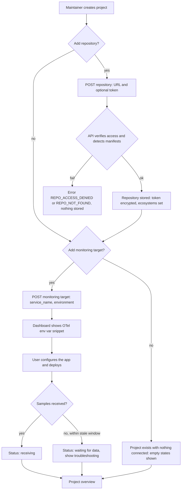
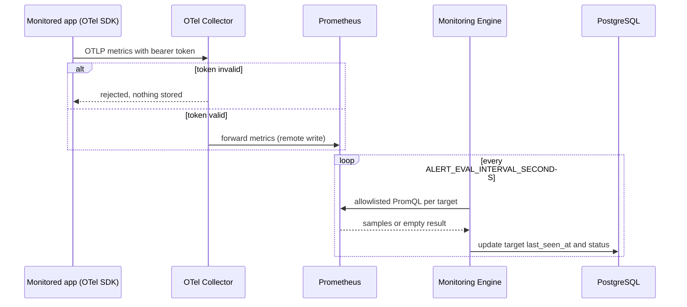
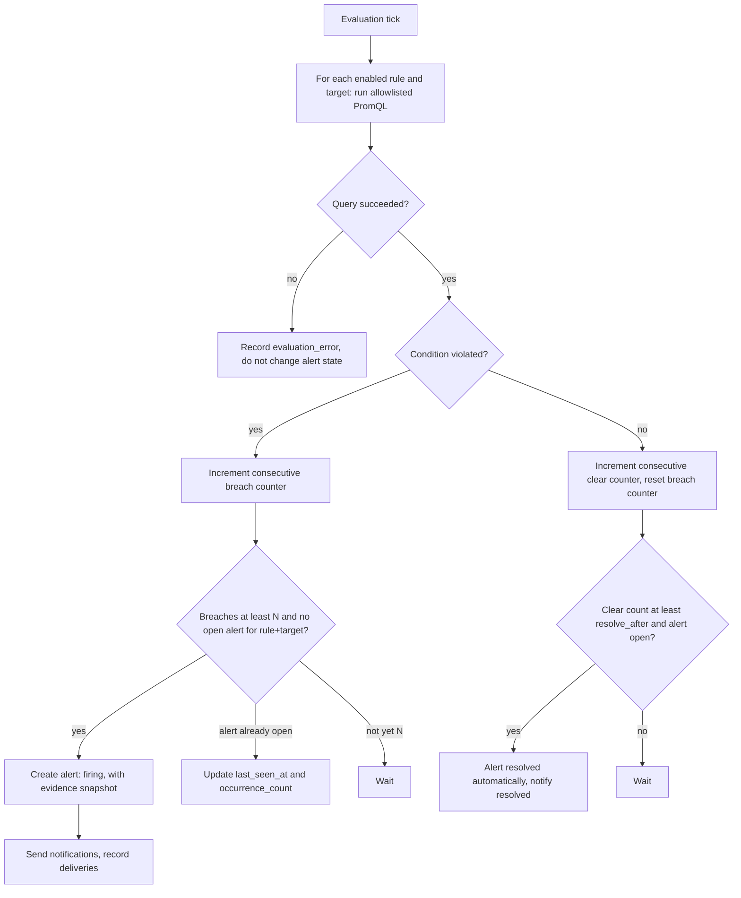
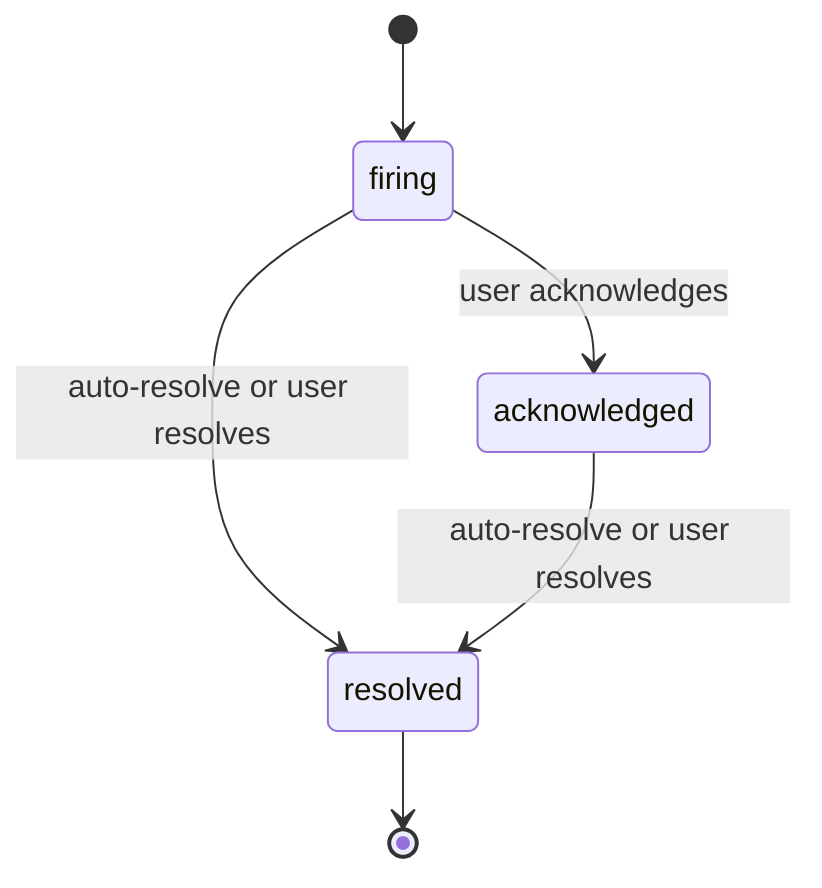
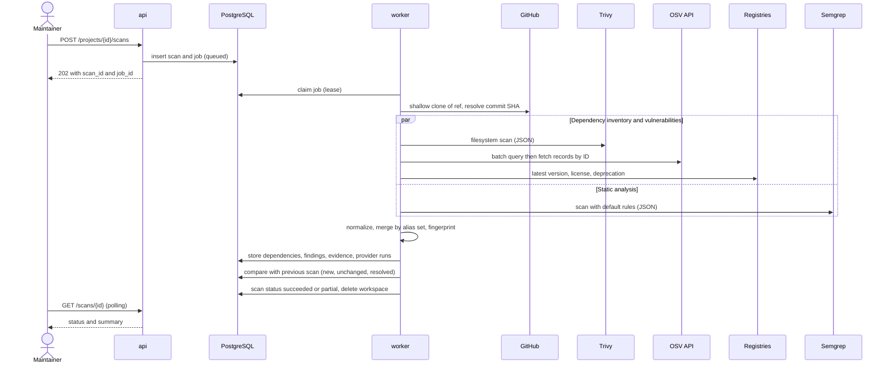
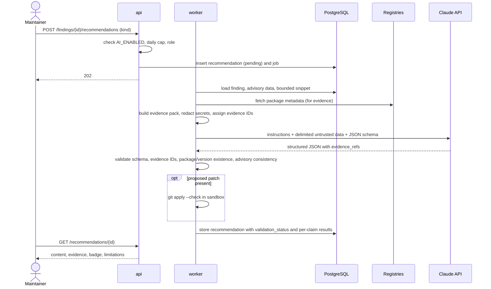
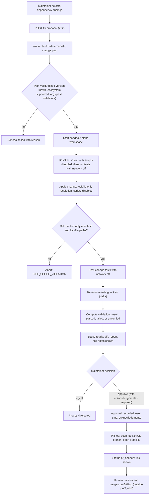
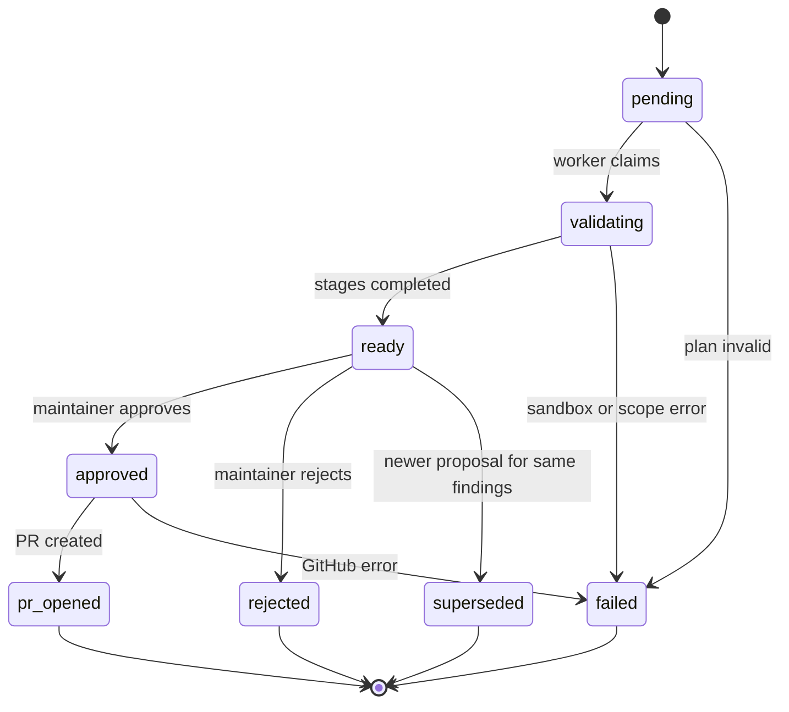
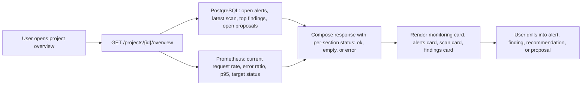
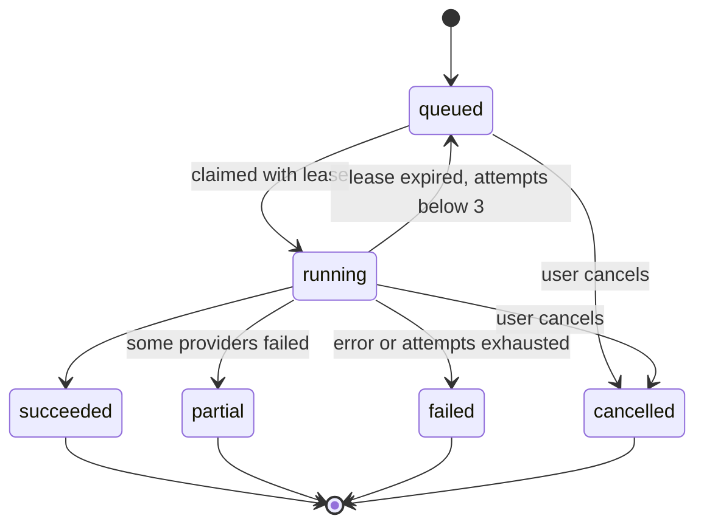

# Workflows

> **Doc:** WORKFLOW.md · **Version:** 0.1 · **Date:** 2026-10-13 · **Status:** Draft · **Related:** [FRD](FRD.md), [ARCHITECTURE](ARCHITECTURE.md), [API_SPEC](API_SPEC.md)

Workflow IDs (`WF-nn`) describe end-to-end behavior. The three product flows are separate and converge only in the dashboard (WF-07):

| ID | Workflow | Kind |
|---|---|---|
| WF-01 | Project onboarding (repository + monitoring target) | Interactive + async verification |
| WF-02 | Live telemetry collection | Continuous, push |
| WF-03 | Alert evaluation, notification, and lifecycle | Continuous loop |
| WF-04 | Repository scan (dependencies + static analysis) | Async job |
| WF-05 | AI-assisted recommendation | Async job |
| WF-06 | Fix proposal, approval, and draft PR | Async jobs + human gate |
| WF-07 | Convergence in the unified dashboard | Read-only composition |

## WF-01 Project onboarding

**Rules.** A project may have a repository, targets, both, or neither (FR-PRJ-05). Tokens are write-only. Verification does not clone the repository; it calls GitHub metadata and contents endpoints with a 10-second timeout.

## WF-02 Live telemetry collection

**Scope note.** Only metrics are collected. Target status is derived from the presence of recent samples for the target's `service_name`; it does not mean the application is healthy.

## WF-03 Alert evaluation, notification, and lifecycle

**Evidence snapshot (FR-ALR-04):** PromQL used, observed value, threshold, evaluation window, guidance text. Illegal transitions return `409 INVALID_TRANSITION`. A new breach after `resolved` creates a **new** alert.

## WF-04 Repository scan

**Failure handling.** Each provider run is recorded (`ok`, `failed`, `skipped`) with an error summary. If any provider is `failed`, the scan ends `partial`; if the clone fails or the timeout is hit, `failed`. The UI never presents `partial` as a clean result (FR-DEP-07). Repository content is read-only data in this workflow; no repository code is executed.

## WF-05 AI-assisted recommendation

**Decision rule.** `validated` requires every check to pass; any unsupported claim yields `partially_validated` (supported claims shown, unsupported hidden behind a warning) or `rejected` (all claims unsupported or schema failure after one repair attempt). The model has no tools and cannot trigger any action.

## WF-06 Fix proposal, approval, and draft PR

**Approval gates (FR-REM-06, FR-REM-09, FR-REM-12).**

| `validation_result` | Major upgrade? | Approval possible? |
|---|---|---|
| `passed` | no | `maintainer` or `admin` |
| `passed` | yes | needs `acknowledge_breaking_change = true` |
| `unverified` (no or failing baseline tests) | any | needs `acknowledge_unverified = true` |
| `failed` | any | `admin` only, override recorded in audit log |

**Safety invariants:** only branch names starting with `toolkit/fix/` are accepted by COMP-10; draft PR only; no merge call exists in the adapter interface; the approval row must exist before the PR job starts.

**Rollback considerations.** The proposal stores the base commit SHA. Because the change is delivered as a PR, rollback before merge means closing the PR (FR-REM-10 can close it and delete the Toolkit-created branch). After a merge, rollback is a normal `git revert` performed by the team; the PR description includes the revert hint.

## WF-07 Convergence in the unified dashboard

**Rule:** each overview section reports its own status (`ok`, `empty`, `error`) so that a Prometheus outage cannot hide scan results, and vice versa (NFR-REL-05).

## Job lifecycle (all asynchronous work)

`partial` applies to scan jobs only. Job types: `scan`, `recommendation`, `fix_proposal`, `pr_creation`. Cancellation is cooperative: the worker checks the flag between stages and terminates sandbox containers it started.

## Error paths summary

| Situation | System behavior | User sees |
|---|---|---|
| Repo token lacks permission for push | PR job fails; proposal returns to `approved` with `pr_error` | Message naming the missing permission class, retry button |
| Registry returns 429/5xx | Retry with backoff; then provider `failed` | `partial` scan with provider list |
| Claude returns invalid JSON twice | Recommendation `rejected` (`SCHEMA_INVALID`) | "AI output could not be validated" with raw output hidden by default |
| Sandbox test command missing | `validation_result = unverified` | Warning + acknowledgment checkbox |
| Alert webhook returns non-2xx | Delivery `failed`, retried per cooldown policy | Delivery status on alert detail |
